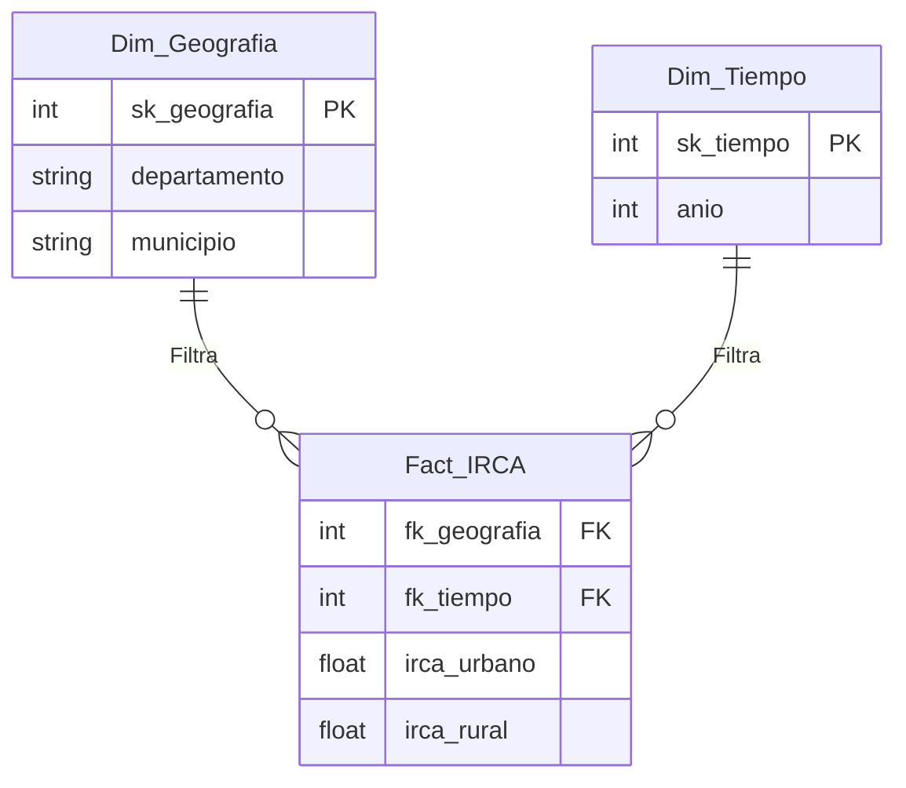
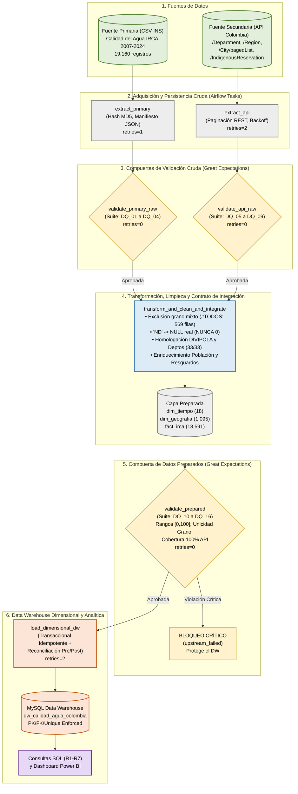
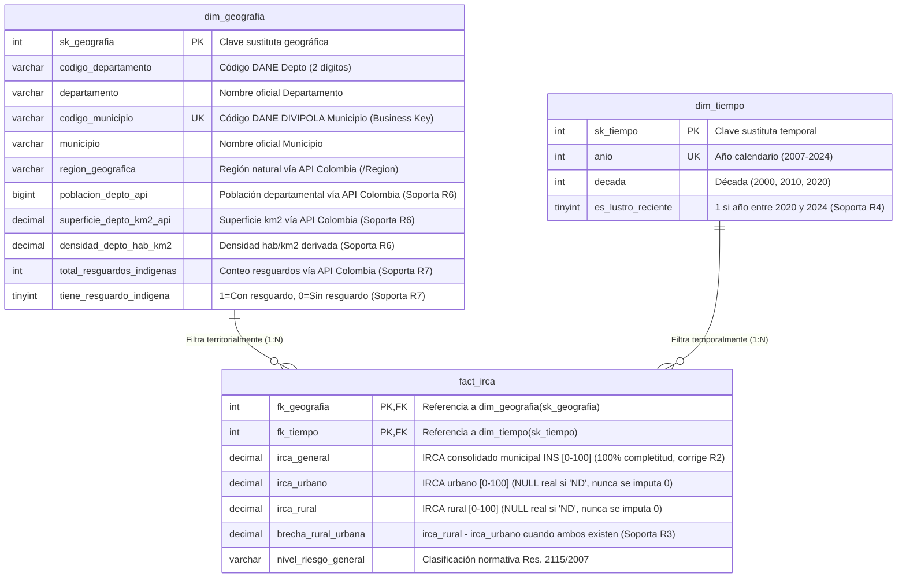

# Proyecto ETL - Segunda Entrega: Automatización de Pipelines, Integración de API y Validación de Calidad de Datos

> **Principio de Ingeniería:** *Un Ingeniero de Datos no construye scripts. Un Ingeniero de Datos diseña sistemas.*

---

## 1. Problema Colombiano y Objetivo Analítico

* **Título del Proyecto:** Sistema Operativo de Ingeniería de Datos para el Análisis Dimensional de la Desigualdad Hídrica (IRCA), Exposición Demográfica y Vulnerabilidad en Territorios Indígenas en Colombia.
* **ODS Seleccionado:** **ODS 6 – Agua Limpia y Saneamiento** (Meta 6.1: Lograr el acceso universal y equitativo al agua potable a un precio asequible para todos; Meta 6.b: Apoyar la participación de las comunidades locales en la mejora de la gestión del agua y el saneamiento).
* **Problema en Colombia:** En Colombia persiste una brecha estructural de acceso a agua potable segura entre cabeceras urbanas, zonas rurales dispersas y territorios con poblaciones étnicas e indígenas. Mientras las principales capitales reportan niveles de **IRCA (Índice de Riesgo de la Calidad del Agua para Consumo Humano)** en el rango de *"Sin Riesgo"* ($0\% - 5\%$), cientos de municipios periféricos y rurales consumen agua en niveles de *"Riesgo Medio"* ($14.1\% - 35\%$), *"Riesgo Alto"* ($35.1\% - 80\%$) o *"Inviable Sanitariamente"* ($80.1\% - 100\%$).
* **Objetivo Analítico de la Segunda Entrega:** Evolucionar la línea base analítica de la Primera Entrega hacia un sistema de ingeniería de datos automatizado, auditable y tolerante a fallos que integre las mediciones históricas del **Instituto Nacional de Salud (INS)** con información demográfica, territorial y de **Resguardos Indígenas** extraída programáticamente desde **API Colombia**, validando la calidad de los datos en **3 compuertas con Great Expectations**, cargando de forma idempotente un **Data Warehouse en MySQL** y orquestando todo el ciclo con **Apache Airflow 3.1.8**.
* **Partes Interesadas (Stakeholders):** Ministerio de Salud y Protección Social, Ministerio de Vivienda, Ciudad y Territorio, Superintendencia de Servicios Públicos Domiciliarios (SSPD), Instituto Nacional de Salud (INS), Gobernaciones, Alcaldías Municipales y Autoridades de Cabildos/Resguardos Indígenas.

---

## 2. Línea Base de la Primera Entrega y Enlace al Repositorio

* **Repositorio de la Primera Entrega (Intacto como referencia obligatoria):** [https://github.com/Big2Welker/Project1ETLSVG](https://github.com/Big2Welker/Project1ETLSVG)
* **Resumen de la Línea Base (Entrega 1):**
  En la Primera Entrega se construyó un pipeline modular en Python que extraía el archivo histórico del INS (`Calidad_del_Agua_para_Consumo_Humano_en_Colombia_20260905.csv`), filtraba los subtotales departamentales (`#TODOS`), estructuraba un Esquema Estrella básico (`dim_tiempo`, `dim_geografia`, `fact_irca`) y lo cargaba en MySQL para responder los requisitos **R1 a R5**.
* **Limitación Crítica Detectada en la Revisión de la Entrega 1 (Feedback del Profesor):**
  En la consulta analítica **R2** de la Entrega 1 se utilizó la expresión `AVG((COALESCE(f.irca_urbano, 0) + COALESCE(f.irca_rural, 0)) / 2)`. En la escala normativa del IRCA (Resolución 2115 de 2007), **$0\%$ significa "Agua Sin Riesgo" (agua 100% potable)**. Como el $51.3\%$ de los registros municipales (`9,538` filas) tienen `IRCArural = 'ND'` (`NULL`), reemplazar esos faltantes con `0` reducía artificialmente a la mitad el promedio de riesgo de departamentos enteros (ej. Chocó pasaba de un riesgo real de **$50.83\%$** a un riesgo sesgado de **$25.41\%$**) y alteraba el Top 5 nacional.

### Modelo Dimensional Anterior (Línea Base Entrega 1)


---

## 3. Estado y Decisiones de Cambio para R1–R5 (Continuidad)

| Requisito | Estado | Cambio Introducido | Justificación Analítica y de Diseño | Salida Analítica (2da Entrega) |
| :--- | :--- | :--- | :--- | :--- |
| **R1** (Evolución histórica nacional del IRCA desde 2007) | **Refinar** | Se incorpora la serie histórica del atributo oficial consolidado `irca_general` junto a `irca_urbano` e `irca_rural`, calculando `AVG()` exclusivamente sobre mediciones válidas (`NULL` ignorado). | Permite comparar la tendencia nacional total ($28.20\%$ en 2007 $\rightarrow$ $10.72\%$ en 2024) frente a las trayectorias urbana y rural sin sesgos por datos faltantes. | Gráfico de líneas triple (IRCA General, Urbano y Rural 2007–2024) y KPI de reducción histórica nacional. |
| **R2** (Identificar el Top 5 de departamentos con peor calidad de agua actual) | **Refinar (Corrección Crítica)** | Se **elimina** `COALESCE(irca, 0)` y se evalúa el ranking sobre el atributo oficial `irca_general` en `fact_irca`, reportando en paralelo los promedios urbano y rural reales. | **Corrección directa del feedback del profesor:** Imputar `0` equivalía a asumir agua óptima en `8,968` registros con una zona en `'ND'`. Con la corrección, en 2024 el Top 5 real es **Chocó ($50.83\%$)**, **Guainía ($32.80\%$)**, **Cesar ($22.09\%$)**, **Nariño ($20.31\%$)** y **Bolívar ($19.10\%$)** (antes salían Caldas y Risaralda por distorsión). | Gráfico de barras horizontales Top 5 Departamentos Críticos 2024 + Tabla comparativa del sesgo corregido. |
| **R3** (Comparar riesgo entre zona urbana y rural por departamento) | **Refinar** | Se añade la métrica derivada `brecha_rural_urbana` en `fact_irca`, calculada **únicamente** cuando el municipio tiene medición real en ambas zonas (`irca_rural IS NOT NULL AND irca_urbano IS NOT NULL`). | Evita restar contra ceros ficticios y permite distinguir entre la brecha departamental agregada y la brecha municipal pareada. | Gráfico de columnas agrupadas Urbano vs. Rural y ranking de Brecha Hídrica Departamental. |
| **R4** (Detectar municipios en "Alto Riesgo" constante en los últimos 5 años) | **Refinar** | Se añade el atributo `es_lustro_reciente` en `dim_tiempo` (2020–2024) y `codigo_municipio` (DIVIPOLA) en `dim_geografia`, evaluando `irca_general > 35 OR irca_rural > 35` durante los 5 años consecutivos. | Evita colisiones por municipios homónimos en distintos departamentos (ej. *Córdoba*, *Sucre*, *Ricaurte*) y captura municipios sin desglose rural pero con IRCA general crítico. | Matriz de calor / Tabla de los **65 municipios crónicos** liderados por Zaragoza ($74.66\%$) y Roncesvalles ($72.76\%$). |
| **R5** (Departamentos que más redujeron su riesgo rural en el tiempo) | **Mantener** | Se conserva la lógica de comparación `MIN(anio)` (2007) vs `MAX(anio)` (2024) sobre `AVG(irca_rural)` garantizando filtro `IS NOT NULL` en ambos extremos. | El requerimiento original es analíticamente sólido y demuestra casos de éxito en política pública rural (liderado por Guaviare con $-87.10$ puntos e Huila con $-52.33$ puntos). | Gráfico de barras de cambio neto ($\Delta$ IRCA Rural 2007 vs. 2024). |

---

## 4. Nuevos Requisitos Analíticos Integrados (R6 y R7)

Cada nuevo requisito exige obligatoriamente combinar atributos de la **Fuente Primaria (CSV INS)** y de la **Fuente Secundaria (API Colombia)**:

| ID | Requisito Analítico Integrado | Datos Fuente Primaria (CSV INS) | Datos Fuente API (API Colombia) | Estrategia o Clave de Integración | KPI o Medida Esperada | Nivel de Detalle (Grano) |
| :--- | :--- | :--- | :--- | :--- | :--- | :--- |
| **R6** | **Exposición Demográfica Departamental al Riesgo Hídrico y Densidad Territorial:** Cuantificar la población departamental estimada expuesta a agua en riesgo medio/alto ($\text{IRCA} > 14\%$) y evaluar su relación con la densidad demográfica y región natural. | `Departamento`, `DepartamentoCodigo`, `MunicipioCodigo`, `Año`, `IRCA` (`irca_general`). | `/api/v1/Department`: `name`, `population`, `surface`, `regionId`.<br>`/api/v1/Region`: `id`, `name`. | Normalización ortográfica + Diccionario de homologación departamental (`depto_norm`) enriqueciendo `dim_geografia` (100% cobertura: 33/33 deptos). | **KPI 1:** Población Estimada Expuesta a Riesgo ($\text{Pob}_{\text{API}} \times \frac{\text{Mpios}_{\text{IRCA}>14\%}}{\text{Mpios}_{\text{Eval}}}$).<br>**KPI 2:** Densidad Demográfica ($\text{hab/km}^2$) vs. IRCA Promedio. | Departamental y Regional en el corte anual vigente (2024). |
| **R7** | **Brecha de Vulnerabilidad Hídrica en Municipios con Resguardos Indígenas:** Determinar si los municipios con presencia de Resguardos Indígenas presentan mayor riesgo hídrico rural y general que el resto del país, identificando los territorios indígenas en estado crítico. | `Departamento`, `Municipio`, `MunicipioCodigo`, `Año`, `IRCA`, `IRCArural`, `Nivel de riesgo`. | `/api/v1/IndigenousReservation/pagedList`: `id`, `name`, `code`, `city` (`name`), `department` (`name`).<br>`/api/v1/City/pagedList`. | Agregación de conteo de resguardos por llave compuesta normalizada `(depto_norm, mpio_norm)` integrada en `dim_geografia` (`total_resguardos_indigenas`, `tiene_resguardo_indigena`). | **KPI 1:** Brecha de IRCA Rural Histórico en Municipios Con Resguardo ($42.14\%$) vs. Sin Resguardo ($37.31\%$).<br>**KPI 2:** Top 10 Municipios Indígenas en Riesgo Alto / Inviable. | Municipal y por Condición Territorial Indígena (Serie 2007–2024 y corte 2024). |

---

## 5. Fuente Primaria y Nueva Fuente API (Idoneidad y Documentación Técnica)

### 5.1 Fuente Primaria
* **Proveedor:** Instituto Nacional de Salud (INS) – SIVICAP / Portal de Datos Abiertos de Colombia (`datos.gov.co`).
* **Archivo:** [data/raw/primary/Calidad_del_Agua_para_Consumo_Humano_en_Colombia_20260905.csv](file:///c:/ETL/ProyectosEtl/Proyecto2/data/raw/primary/Calidad_del_Agua_para_Consumo_Humano_en_Colombia_20260905.csv) (`19,160` registros totales; `18,591` registros atómicos municipales tras aislar `569` filas `#TODOS`).

### 5.2 Documentación Técnica de la Fuente API (Sección 4.1)

| Ítem | Documentación Técnica Requerida |
| :--- | :--- |
| **Proveedor y propósito** | **API Colombia** (`https://api-colombia.com/api/v1`), servicio REST abierto mantenido por la comunidad de datos abiertos de Colombia que provee información oficial estandarizada sobre división político-administrativa, demografía departamental/municipal, regiones naturales y resguardos indígenas registrados en el país. |
| **Valor analítico (Sección 6)** | El CSV del INS solo contiene porcentajes de riesgo (IRCA), pero **carece por completo de población, extensión territorial ($\text{km}^2$), regiones naturales y presencia de comunidades indígenas**. Sin la API es imposible saber si un IRCA alto ocurre en un departamento de 50,000 o de 2,200,000 habitantes (R6), ni focalizar inversiones en territorios con resguardos indígenas (R7). |
| **Endpoints y parámetros** | 1. `GET /api/v1/Department` (Catálogo de los 33 departamentos con `population`, `surface`, `regionId`).<br>2. `GET /api/v1/Region` (Catálogo de las 6 regiones naturales).<br>3. `GET /api/v1/City/pagedList?Page={p}&PageSize=200` (Catálogo paginado de los 1,123 municipios).<br>4. `GET /api/v1/IndigenousReservation/pagedList?Page={p}&PageSize=200` (Catálogo paginado de los 829 resguardos indígenas). |
| **Respuesta y atributos conservados** | Formato `application/json` (UTF-8). En endpoints paginados devuelve el sobre `{"page", "pageSize", "totalRecords", "pageCount", "data": [...]}`. Se conservan: `Department` (`id`, `name`, `population`, `surface`, `regionId`), `Region` (`id`, `name`), `IndigenousReservation` (`id`, `name`, `code`, `cityId`, `city.name`, `department.name`). |
| **Autenticación y Seguridad** | API pública REST sobre HTTPS sin token secreto. La URL base, timeouts y tamaños de página se parametrizan mediante variables de entorno en `.env` (documentadas en [.env.example](file:///c:/ETL/ProyectosEtl/Proyecto2/.env.example)), junto con las credenciales de MySQL que nunca se suben al repositorio. |
| **Comportamiento operativo** | Implementado en [src/extract_api.py](file:///c:/ETL/ProyectosEtl/Proyecto2/src/extract_api.py): recorrido automático de páginas (`Page=1..N` hasta `pageCount`), pausa cortés de `0.15s` entre páginas para evitar *rate-limiting*, `timeout=25s` por petición y política de reintento con *exponential backoff* (`max_retries=3`). Genera el manifiesto auditable `api_manifest_{batch_id}.json`. |
| **Reproducibilidad** | Cualquier evaluador puede ejecutar `python src/extract_api.py` o disparar la tarea `extract_api` en Airflow para realizar las peticiones HTTP en vivo y verificar los archivos crudos persistidos en `data/raw/api/`. |

---

## 6. Valor Analítico Aportado por la API y Mapeo de Atributos

| Atributo | Fuente de Origen | Endpoint / Columna Cruda | Uso Downstream en el Sistema | Requisito Soportado |
| :--- | :--- | :--- | :--- | :--- |
| `codigo_municipio`, `codigo_departamento` | Fuente Primaria (CSV INS) | `MunicipioCodigo`, `DepartamentoCodigo` | Clave de negocio única (`UNIQUE`) en `dim_geografia` y llave de desambiguación para municipios homónimos. | R1–R7 |
| `irca_general`, `irca_urbano`, `irca_rural` | Fuente Primaria (CSV INS) | `IRCA`, `IRCAurbano`, `IRCArural` | Medidas de hecho en `fact_irca`. `irca_general` corrige el sesgo de R2; `irca_urbano` y `irca_rural` preservan `NULL` real. | R1–R7 |
| `region_geografica` | Fuente API (API Colombia) | `GET /api/v1/Region` (`name`) | Atributo jerárquico en `dim_geografia` para agrupar departamentos por Región Natural (Caribe, Pacífico, Andina, etc.). | R2, R4, R6, R7 |
| `poblacion_depto_api`, `superficie_depto_km2_api` | Fuente API (API Colombia) | `GET /api/v1/Department` (`population`, `surface`) | Atributos demográficos en `dim_geografia` y base del cálculo de `densidad_depto_hab_km2` y población expuesta. | R6 |
| `total_resguardos_indigenas`, `tiene_resguardo_indigena` | Fuente API (API Colombia) | `GET /api/v1/IndigenousReservation/pagedList` | Conteo e indicador booleano (`1/0`) en `dim_geografia` para segmentar el riesgo hídrico en territorios indígenas. | R7 |

---

## 7. Arquitectura del Sistema

*(También disponible en [docs/ETL_Architecture.md](file:///c:/ETL/ProyectosEtl/Proyecto2/docs/ETL_Architecture.md))*



---

## 8. Hallazgos del Perfilado de Datos (Data Profiling)

El código reproducible de perfilado se encuentra en [notebooks/data_profiling.py](file:///c:/ETL/ProyectosEtl/Proyecto2/notebooks/data_profiling.py) y su salida estructurada en [docs/evidence/profiling_summary.json](file:///c:/ETL/ProyectosEtl/Proyecto2/docs/evidence/profiling_summary.json). **El perfilado solo observa y produce evidencia sin modificar los datos:**

| Dataset o Atributo | Evidencia Cuantitativa del Perfilado | Riesgo Potencial de Calidad | Requisito Relacionado |
| :--- | :--- | :--- | :--- |
| **CSV Primario:** `Municipio = '#TODOS'` | De las `19,160` filas totales del CSV, exactamente **`569` filas ($2.97\%$)** corresponden a resúmenes departamentales (`#TODOS`) y **`18,591` filas** son municipios atómicos. | **Grano Mixto (Doble Conteo):** Incluir `#TODOS` en la tabla de hechos distorsiona promedios y sumas departamentales/nacionales. | R1–R7 |
| **CSV Primario:** Nulos encubiertos `'ND'` en `IRCA`, `IRCAurbano`, `IRCArural` | En las `18,591` filas municipales: `IRCA` (general) tiene **`0` `'ND'` ($0.0\%$)**; `IRCAurbano` tiene **`1,264` `'ND'` ($6.8\%$)**; `IRCArural` tiene **`9,538` `'ND'` ($51.3\%$)**. En total, **`8,968` filas ($48.2\%$)** tienen dato en una zona pero `'ND'` en la otra. | **Sesgo por Imputación a Cero (Error R2 Entrega 1):** Convertir `'ND'` en `0` asume "Agua Sin Riesgo" ($0\%$) y reduce a la mitad el promedio de riesgo en `8,968` registros. | R1, R2, R3, R4, R5, R7 |
| **CSV Primario:** Formatos y Rangos de `Año` e `IRCA` | `Año` viene formateado con coma de miles (`"2,024"`), cubriendo de `2007` a `2024` (18 años). Al evaluar numéricamente, `IRCA`, `IRCAurbano` e `IRCArural` están en el rango **`[0.0, 100.0]`**. Unicidad de `(MunicipioCodigo, Año)`: **`0` duplicados**. | Fallo de parseo numérico si no se limpian separadores de miles y decimales; riesgo de valores fuera del dominio normativo $[0, 100]$. | R1–R7 |
| **API Colombia:** `/api/v1/Department` vs. `/api/v1/City/pagedList` | `/Department` retorna **`33` registros** con **`0` nulos ($100\%$ completitud)** en `population` y `surface`. En cambio, `/City` retorna **`1,123` municipios**, pero **solo `63` tienen `population` no nulo ($94.39\%$ de nulos)**. | **Incompletitud Demográfica Municipal en la API:** Usar `City.population` dejaría sin población al $94.39\%$ de los municipios. Justifica tomar la población desde `/Department` (`100%` completa). | R6 |
| **API Colombia:** `/api/v1/IndigenousReservation/pagedList` | Retorna **`829` resguardos indígenas** en 5 páginas (`0` nulos en `cityId`), distribuidos en **`232` municipios únicos**. El esquema JSON contiene un *typo* de origen en la propiedad `"deparmentId"` (sin `'t'`), aunque el objeto anidado `"department"` y `"city"` están completos. | Fallo de extracción si se referencia `"departmentId"` plano en vez de inspeccionar el objeto anidado `"department"` y `"city"`. | R7 |
| **Compatibilidad Cruzada (CSV INS $\leftrightarrow$ API Colombia)** | El CSV tiene **34 cadenas distintas** en `Departamento` (porque San Andrés aparece con `"Y"` mayúscula y `"y"` minúscula). Al normalizar tildes/mayúsculas, **31 departamentos cruzan exacto** y **2 difieren en nombre**: `"BOGOTA, D.C."` vs `"BOGOTA"` y `"ARCHIPIELAGO DE SAN ANDRES..."` vs `"SAN ANDRES Y PROVIDENCIA"`. | **Pérdida de Integración (Unmatched Records):** Un `JOIN` directo sin homologación dejaría por fuera a Bogotá y San Andrés en R6 y a capitales como Cartagena de Indias o Cúcuta en R7. | R6, R7 |

---

## 9. Riesgos de Calidad, Reglas de Datos (DQ Rules) y Política de Severidad

Se definieron **16 reglas explícitas (`DQ_01` a `DQ_16`)** distribuidas en las 3 capas del sistema. A continuación se presentan las reglas materiales principales y la justificación de sus umbrales:

| ID Regla | Fuente / Capa | Atributo(s) | Dimensión de Calidad | Regla de Calidad Explícita | Métrica y Umbral Justificado | Severidad | Requisito Protegido |
| :--- | :--- | :--- | :--- | :--- | :--- | :--- | :--- |
| **DQ_01** | Primaria Cruda (`Gate 1`) | Tabla CSV | Completeness & Volume | El archivo primario debe contener el histórico nacional completo (18 años $\times \sim 1,050$ mpios). | `row_count` entre `15,000` y `25,000` filas (Observado: `19,160`). Base histórica contractual del SIVICAP. | **Critical** | R1–R7 |
| **DQ_02** | Primaria Cruda (`Gate 1`) | `IRCA`, `MunicipioCodigo` | Completeness | El indicador consolidado `IRCA` y el código DIVIPOLA no pueden ser nulos en origen. | `null_count == 0` ($100\%$ completitud requerida en llave e indicador principal). | **Critical** | R1, R2, R4 |
| **DQ_04** | Primaria Cruda (`Gate 1`) | `Municipio` | Validity (Domain) | Monitoreo de filas agregadas `#TODOS` antes de transformación. | `mostly >= 0.95` de filas distintas de `'#TODOS'` (Observado: $97.03\%$ municipios atómicos). | **Warning** | R1–R5 |
| **DQ_05** | API Cruda (`Gate 2`) | `/Department` | Completeness & Contract | El endpoint departamental debe retornar la totalidad de unidades territoriales de Colombia. | `row_count == 33` (32 departamentos constitucionales + Distrito Capital). | **Critical** | R6 |
| **DQ_06** | API Cruda (`Gate 2`) | `population`, `surface` | Validity & Range | La población y superficie departamental en la API no pueden ser nulas ni negativas. | `population` $\in [10,000,\ 15,000,000]$ y `surface` $\in [10,\ 200,000]\ \text{km}^2$ ($0$ nulos). | **Critical** | R6 |
| **DQ_08** | API Cruda (`Gate 2`) | `/IndigenousReservation` (`cityId`) | Completeness | Todo resguardo indígena extraído debe estar vinculado a un municipio válido (`cityId`). | `null_count(cityId) == 0` y `row_count >= 500` (Observado: `829` resguardos). | **Critical** | R7 |
| **DQ_09** | API Cruda (`Gate 2`) | `/City` | Completeness | Monitoreo informativo del catálogo municipal de la API. | `row_count` $\in [1,100,\ 1,200]$ (Observado: `1,123` municipios). | **Informational** | R6, R7 |
| **DQ_10 – DQ_12** | Datos Preparados (`Gate 3`) | `irca_general`, `irca_urbano`, `irca_rural` | Validity (Range) | Todo valor numérico de IRCA (incluyendo no nulos de urbano y rural) debe cumplir el rango legal de la Res. 2115/2007. | Valores $\in [0.0,\ 100.0]$ (`0%` a `100%`). Cualquier valor $<0$ o $>100$ es físicamente inválido. | **Critical** | R1–R7 |
| **DQ_13** | Datos Preparados (`Gate 3`) | `(fk_geografia, fk_tiempo)` | Uniqueness (Grain) | Unicidad absoluta del grano compuesto en `fact_irca`. | `duplicate_count == 0` ($100\%$ único para `18,591` combinaciones municipio-año). | **Critical** | R1–R7 |
| **DQ_14 – DQ_16** | Datos Preparados (`Gate 3`) | `dim_geografia` (`codigo_municipio`, `poblacion_depto_api`, `municipio`) | Uniqueness & Consistency | Unicidad de código DIVIPOLA, $100\%$ de cruce con población de API Colombia y ausencia total de `'#TODOS'`. | `unique(codigo_municipio) == 100%`, `poblacion_depto_api > 10,000` en los `1,095` municipios y `0` filas `'#TODOS'`. | **Critical** | R1–R7 |

### Política de Severidad del Pipeline (Sección 8.1)
* **Critical:** Violación inaceptable de contrato o integridad analítica. El módulo lanza `RuntimeError`, la tarea de Airflow pasa a estado `failed`, y **todas las tareas dependientes (incluyendo la carga al Data Warehouse) quedan bloqueadas (`upstream_failed`)**.
* **Warning:** Anomalía conocida o controlada (ej. presencia esperada de $2.97\%$ de filas `#TODOS` en el CSV crudo antes de limpiar). Se registra en el JSON de evidencia de GX (`CONTINUE_WITH_WARNING_LOGGED`) y el flujo continúa hacia la transformación que la corrige.
* **Informational:** Métrica de observabilidad operativa (ej. conteo del catálogo `City`). Se registra en logs y artefactos JSON sin bloquear el flujo.

---

## 10. Diseño de Validación Automatizada con Great Expectations (Secciones 9, 10, 11 y 14)

Implementado en [gx/gx_validation.py](file:///c:/ETL/ProyectosEtl/Proyecto2/gx/gx_validation.py) utilizando **Great Expectations 1.24.0**:

| Elemento Great Expectations | Implementación en el Sistema |
| :--- | :--- |
| **Data Object** | `DataFrameAsset` sobre un contexto efímero (`gx.get_context(mode="ephemeral")`) conectado mediante `add_pandas` y `add_batch_definition_whole_dataframe` para cada lote evaluado (`primary_raw_csv`, `api_depts_raw`, `api_indig_raw`, `prepared_fact_irca`, `prepared_dim_geografia`). |
| **Expectations** | Instancias nativas de `gx.expectations` (`ExpectTableRowCountToBeBetween`, `ExpectColumnValuesToNotBeNull`, `ExpectColumnValuesToNotBeInSet`, `ExpectColumnValuesToBeBetween`, `ExpectCompoundColumnsToBeUnique`, `ExpectColumnValuesToBeUnique`), cada una vinculada a su `rule_id` (`DQ_01` a `DQ_16`). |
| **Expectation Suites** | 3 compuertas separadas por capa:<br>1. **Compuerta 1 (`validate_primary_raw_gate`):** `suite_primary_raw`.<br>2. **Compuerta 2 (`validate_api_raw_gate`):** `suite_api_departments_raw`, `suite_api_indigenous_raw`, `suite_api_cities_raw`.<br>3. **Compuerta 3 (`validate_prepared_gate`):** `suite_prepared_fact_irca`, `suite_prepared_dim_geografia`. |
| **Validation Definition & Execution** | `gx.ValidationDefinition(name=..., data=batch_def, suite=suite).run(batch_parameters={"dataframe": df})` invocado de forma determinista por cada tarea de validación del DAG. |
| **Validation Result & Pipeline Response** | Genera reportes JSON detallados en `docs/evidence/gx_gate{1,2,3}_*.json` con `observed_value`, `element_count`, `unexpected_count`, `unexpected_percent` y `pipeline_action` (`PROCEED_NORMAL` o `BLOCK_DW_LOAD_CRITICAL_FAILURE`). |

---

## 11. Estrategia de Transformación y Contrato de Integración (Secciones 13 y 13.1)

Implementado en [src/transform_integrate.py](file:///c:/ETL/ProyectosEtl/Proyecto2/src/transform_integrate.py).

### 11.1 Registro de Transformaciones Significativas

| ID Transf. | Regla o Justificación de Ingeniería | Campos Afectados | Comportamiento Antes y Después | Manejo de Excepciones | Impacto Analítico / Dimensional |
| :--- | :--- | :--- | :--- | :--- | :--- |
| **T01** | Aislar el grano atómico municipal eliminando los subtotales departamentales del INS. | `Municipio`, `MunicipioCodigo` | **Antes:** `19,160` filas (incluye `569` filas `#TODOS`).<br>**Después:** `18,591` filas exclusivamente municipales. | Se audita el conteo exacto excluido (`excluded_todos_rows = 569`) en el JSON de reconciliación. | Garantiza grano homogéneo en `fact_irca` y evita doble conteo. |
| **T02** | **Corrección Crítica R2:** Convertir `'ND'` en `NULL` real (`np.nan` $\rightarrow$ SQL `NULL`) y conservar `irca_general` sin imputar `0`. | `IRCA`, `IRCAurbano`, `IRCArural` | **Antes:** Strings con coma decimal (`"14,8"`) y `"ND"` (`9,538` en rural; `1,264` en urbano).<br>**Después:** ` DECIMAL(6,2)` con `NULL` real donde no hubo muestra. | Valores no parseables se convierten a `np.nan` y se validan en `Gate 3`. | Elimina el sesgo que reducía a la mitad el promedio de riesgo en `8,968` filas y corrige el ranking R2. |
| **T03** | Estandarización de códigos DANE DIVIPOLA y parseo de año. | `DepartamentoCodigo`, `MunicipioCodigo`, `Año` | **Antes:** `"5"`, `"5001"`, `"2,024"`.<br>**Después:** `"05"`, `"05001"` (5 dígitos estándar), `2024` (`INT`). | `zfill(2)` y `zfill(5)` garantizan longitud fija para la llave de negocio `codigo_municipio`. | Permite usar `codigo_municipio` como `UNIQUE` Business Key en `dim_geografia` (1,095 municipios). |
| **T04** | Derivación de `brecha_rural_urbana` y clasificación normativa Res. 2115/2007. | `brecha_rural_urbana`, `nivel_riesgo_general` | **Antes:** No existía brecha precalculada.<br>**Después:** `irca_rural - irca_urbano` solo cuando ambos son `NOT NULL`. | Si una zona es `NULL`, la brecha municipal queda `NULL` (no se resta contra `0`). | Soporta análisis exacto de desigualdad intradepartamental en R3. |
| **T05** | Homologación e integración con **API Colombia** (Departamentos, Regiones y Resguardos Indígenas). | `region_geografica`, `poblacion_depto_api`, `densidad_depto_hab_km2`, `total_resguardos_indigenas` | **Antes:** Dimensiones sin contexto demográfico ni étnico.<br>**Después:** `dim_geografia` enriquecida para los `1,095` municipios. | Diccionario explícito para Bogotá y San Andrés + normalización NFD sin tildes. | Habilita las consultas integradas R6 y R7 directamente sobre el Esquema Estrella. |

### 11.2 Contrato de Integración (Sección 13.1)

| Elemento del Contrato | Decisión de Ingeniería y Evidencia Empírica |
| :--- | :--- |
| **Claves de integración** | 1. **Nivel Departamental (`CSV` $\leftrightarrow$ `API /Department`):** Clave derivada normalizada `depto_norm` (mayúsculas, sin diacríticos NFD + diccionario de homologación).<br>2. **Nivel Municipal Indígena (`CSV` $\leftrightarrow$ `API /IndigenousReservation`):** Clave compuesta normalizada `(depto_norm, mpio_norm)`. |
| **Cardinalidad** | • `API Department (1) : (N) Municipios en dim_geografia` (33 departamentos enriquecen 1,095 municipios).<br>• `Municipio en dim_geografia (1) : (0..N) Resguardos en API IndigenousReservation` (agregado previamente por municipio como `total_resguardos_indigenas` para preservar relación `1:1` con `dim_geografia`). |
| **Preprocesamiento** | Función `normalize_key()` elimina tildes (`NFD`), signos y espacios dobles. `DEPT_HOMOLOGATION_MAP` unifica las dos variantes de San Andrés del CSV (`"... Y Santa Catalina"` y `"... y Santa Catalina"`) hacia `"SAN ANDRES Y PROVIDENCIA"` y `"BOGOTA, D.C."` hacia `"BOGOTA"`. `CITY_HOMOLOGATION_MAP` alinea nombres oficiales (ej. `"CARTAGENA DE INDIAS"` $\rightarrow$ `"CARTAGENA"`, `"SAN JOSE DE CUCUTA"` $\rightarrow$ `"CUCUTA"`). |
| **Alineación temporal** | El CSV cubre series anuales `2007–2024`. La API provee el corte estructural demográfico y de resguardos vigente. En R6 el cruce de población expuesta se evalúa estrictamente contra el corte más reciente del CSV (`anio = 2024`), y en R7 la presencia de resguardos actúa como atributo territorial conformado en `dim_geografia`. |
| **Registros no coincidentes (Unmatched)** | • **Departamentos:** **0 no coincidentes ($100.0\%$ de cobertura:** los `1,095` municipios de `dim_geografia` reciben población, superficie y región).<br>• **Resguardos Indígenas:** De `232` municipios únicos en la API, **`207` municipios ($89.2\%$)** cruzan con municipios que tienen mediciones SIVICAP en el CSV; los `25` restantes corresponden a áreas no municipalizadas o municipios sin reporte histórico en el INS (y los municipios sin resguardos reciben `total_resguardos_indigenas = 0`). |
| **Duplicados o coincidencias ambiguas** | En Colombia existen municipios con el mismo nombre en diferentes departamentos (ej. *Armenia* en Quindío y Antioquia; *Albania* en Caquetá, La Guajira y Santander). Por eso **se prohibió cruzar solo por nombre de municipio** y se exigió la llave compuesta `(depto_norm, mpio_norm)` más la clave única `codigo_municipio` (DIVIPOLA). |
| **Supuestos y Limitaciones** | **Supuesto:** La proporción de municipios con $\text{IRCA} > 14\%$ en un departamento refleja la exposición demográfica departamental (R6).<br>**Limitación documentada:** Dado que `/api/v1/City` presenta $94.39\%$ de nulos en `population`, no se puede calcular población expuesta por municipio individual sin una fuente censal adicional; por ello R6 se formula rigurosamente a nivel departamental donde la completitud de la API es del $100\%$. |

---

## 12. Revisión y Refinamiento del Modelo Dimensional (Sección 12)

*(También disponible en [docs/Star_Schema.md](file:///c:/ETL/ProyectosEtl/Proyecto2/docs/Star_Schema.md) y DDL en [sql/create_dw.sql](file:///c:/ETL/ProyectosEtl/Proyecto2/sql/create_dw.sql))*



### Justificación de Cambios del Modelo Dimensional (Change Log)
1. **Confirmación del Grano de `fact_irca`:** *"Una fila en `fact_irca` representa la medición anual consolidada del Índice de Riesgo de la Calidad del Agua (IRCA general, urbano, rural y brecha rural-urbana) para un municipio específico de Colombia en un año determinado"*.
2. **¿Por qué la API enriquece `dim_geografia` en lugar de crear otra tabla de hechos?** Porque los atributos extraídos de `API Colombia` (región natural, población/superficie estática departamental y número de resguardos indígenas asentados en el municipio) son **propiedades estructurales del territorio (dimensión espacial)** que permiten filtrar, agrupar y ponderar los hechos del IRCA sin alterar el grano anual-municipal de `fact_irca`.
3. **Adición de `irca_general` y `brecha_rural_urbana` en `fact_irca`:** Resuelve el hallazgo del profesor en R2 (100% completitud sin usar `COALESCE` a cero) y precalcula la brecha pareada para R3.
4. **Adición de `codigo_municipio` (UNIQUE Business Key) en `dim_geografia`:** Garantiza que los `1,095` municipios se identifiquen por su código oficial DANE de 5 dígitos.

---

## 13. Implementación del Data Warehouse y Reconciliación de Carga (Sección 15)

Implementado en [src/load_dw.py](file:///c:/ETL/ProyectosEtl/Proyecto2/src/load_dw.py) sobre **MySQL 8.0** (`dw_calidad_agua_colombia`).
* **Evidencia de Reconciliación ([docs/evidence/dw_load_reconciliation_test_A_success.json](file:///c:/ETL/ProyectosEtl/Proyecto2/docs/evidence/dw_load_reconciliation_test_A_success.json)):**
  * Filas crudas CSV: `19,160` $-$ Filas `#TODOS` excluidas: `569` $=$ Filas atómicas esperadas: **`18,591`**.
  * `dim_tiempo`: **`18` filas** preparadas $=$ **`18` filas** cargadas en MySQL (2007–2024).
  * `dim_geografia`: **`1,095` filas** preparadas $=$ **`1,095` filas** cargadas en MySQL.
  * `fact_irca`: **`18,591` filas** preparadas $=$ **`18,591` filas** cargadas en MySQL.
  * `NULL`s reales preservados en `fact_irca.irca_rural`: **`9,538` registros** (exactamente igual al conteo de `'ND'` del perfilado).

---

## 14. Orquestación con Apache Airflow 3.1.8 e Interfaces de Tareas (Secciones 16, 17, 18 y 19)

El DAG está implementado en [dags/etl_irca_api_dag.py](file:///c:/ETL/ProyectosEtl/Proyecto2/dags/etl_irca_api_dag.py) utilizando exactamente la interfaz requerida:
```python
from airflow.sdk import dag, task
```

### 14.1 Interfaces de Tareas (Sin transporte masivo por XCom - Sección 17)

| Tarea Airflow (`task_id`) | Contrato de Entrada (Input) | Contrato de Salida (Output XCom Compacto) | Identidad del Lote | Señal de Fallo |
| :--- | :--- | :--- | :--- | :--- |
| `extract_primary` | Ruta del CSV primario y `ETL_BATCH_ID`. | `{batch_id, primary_csv_path, raw_row_count}` + Manifiesto JSON con hash MD5. | `batch_id` + `file_md5` | `FileNotFoundError` |
| `extract_api` | `API_COLOMBIA_BASE_URL` y `ETL_BATCH_ID`. | `{batch_id, api_raw_dir, departments_extracted, cities_extracted, indigenous_extracted}` + JSONs crudos. | `batch_id` + `extraction_timestamp_utc` | `RuntimeError` tras agotar reintentos HTTP. |
| `validate_primary_raw` | Referencia compacta de `extract_primary`. | `{batch_id, primary_csv_path, gate1_action, critical_failures}` + Evidencia GX Gate 1. | `batch_id` | `RuntimeError` si `critical_failures > 0`. |
| `validate_api_raw` | Referencia compacta de `extract_api`. | `{batch_id, api_raw_dir, gate2_action, critical_failures}` + Evidencia GX Gate 2. | `batch_id` | `RuntimeError` si `critical_failures > 0`. |
| `transform_and_clean_and_integrate` | Salidas validadas de `validate_primary_raw` y `validate_api_raw`. | `{batch_id, prepared_dir, fact_irca_rows, dim_geografia_rows}` + CSVs preparados. | `batch_id` | Excepción si falla la transformación. |
| `validate_prepared` | Referencia compacta de `transform_and_clean_and_integrate`. | `{batch_id, prepared_dir, gate3_action, critical_failures}` + Evidencia GX Gate 3. | `batch_id` | `RuntimeError` si `critical_failures > 0` (**Bloquea `load_dimensional_dw`**). |
| `load_dimensional_dw` | Referencia validada de `validate_prepared`. | `{batch_id, database, post_load_counts, reconciliation_passed}` + Auditoría en MySQL. | `batch_id` en tabla `etl_batch_audit` | `AssertionError` / `SQLAlchemyError` (Rollback transaccional). |

### 14.2 Política de Manejo de Fallos y Reintentos Selectivos (Sección 18)

*(No se utiliza un `retries=3` genérico en todas las tareas; cada configuración está justificada por la naturaleza del fallo):*

| Condición / Tarea | Clase de Fallo | Respuesta del Pipeline | Configuración de Retry | Justificación de Ingeniería |
| :--- | :--- | :--- | :--- | :--- |
| Timeout o caída temporal en `extract_api` | **Fallo Operativo Transitorio** | Reintentar con espera exponencial; si persiste, detener rama API. | `retries=2`, `retry_delay=30s` (más backoff interno de 3 intentos HTTP) | Durante las pruebas reales se observó un timeout transitorio de red en API Colombia tras múltiples llamadas paginadas; el reintento resuelve el problema sin intervención humana. |
| Bloqueo temporal de conexión en `load_dimensional_dw` | **Fallo Operativo Transitorio** | Rollback de la transacción SQL actual y reintento controlado. | `retries=2`, `retry_delay=30s` | Una desconexión momentánea al contenedor MySQL puede superarse en el siguiente intento gracias a que la carga es transaccional e idempotente. |
| Violación de Regla Crítica en `validate_primary_raw`, `validate_api_raw` o `validate_prepared` | **Fallo Determinista de Datos / Contrato** | **Detener inmediatamente (`failed`)**, preservar JSON de Great Expectations y bloquear tareas downstream (`upstream_failed`). | **`retries=0`** | Reintentar automáticamente sobre el mismo lote corrupto (ej. `irca_general = 145.0` o esquema roto) siempre producirá el mismo fallo y solo desperdicia recursos. |

---

## 15. Evidencia de las Pruebas de Confiabilidad Obligatorias (Sección 20)

Todas las pruebas fueron ejecutadas mediante [src/main.py](file:///c:/ETL/ProyectosEtl/Proyecto2/src/main.py) y sus resultados completos quedaron registrados en [docs/evidence/reliability_tests_summary.json](file:///c:/ETL/ProyectosEtl/Proyecto2/docs/evidence/reliability_tests_summary.json):

### 15.1 Prueba A: Ejecución Exitosa (`batch_id = test_A_success`)
* **Resultado:** Todas las 7 tareas del grafo finalizaron en estado **`success`**.
* **Evidencias generadas:**
  * Compuerta 1 Cruda: [docs/evidence/gx_gate1_primary_raw_test_A_success.json](file:///c:/ETL/ProyectosEtl/Proyecto2/docs/evidence/gx_gate1_primary_raw_test_A_success.json) (`0` fallos críticos $\rightarrow$ `PROCEED_NORMAL`).
  * Compuerta 2 API Cruda: [docs/evidence/gx_gate2_api_raw_test_A_success.json](file:///c:/ETL/ProyectosEtl/Proyecto2/docs/evidence/gx_gate2_api_raw_test_A_success.json) (`0` fallos críticos $\rightarrow$ `PROCEED_NORMAL`).
  * Compuerta 3 Preparada: [docs/evidence/gx_gate3_prepared_test_A_success.json](file:///c:/ETL/ProyectosEtl/Proyecto2/docs/evidence/gx_gate3_prepared_test_A_success.json) (`0` fallos críticos $\rightarrow$ `PROCEED_TO_DW_LOAD`).
  * Reconciliación MySQL: [docs/evidence/dw_load_reconciliation_test_A_success.json](file:///c:/ETL/ProyectosEtl/Proyecto2/docs/evidence/dw_load_reconciliation_test_A_success.json) (`18` años, `1,095` municipios, `18,591` hechos cargados).

### 15.2 Prueba B: Fallo de Calidad Crítico Controlado (`batch_id = test_B_critical_failure`)
* **Condición Inyectada:** Se activó `inject_critical_failure=True`, mutando un registro de `fact_irca.irca_general` al valor ilegal de **`145.0%`** (violando la Regla Crítica **`DQ_10`**: rango legal $[0.0, 100.0]$ que protege R1–R7).
* **Comportamiento Observado de las Tareas:**
  * `extract_primary`: `success`
  * `extract_api`: `success`
  * `validate_primary_raw`: `success`
  * `validate_api_raw`: `success`
  * `transform_and_clean_and_integrate`: `success` (con mutación controlada)
  * `validate_prepared`: **`failed`** (Detectó `unexpected_count = 1`, valor `145.0`, acción `BLOCK_DW_LOAD_CRITICAL_FAILURE`).
  * `load_dimensional_dw`: **`upstream_failed (BLOCKED)`** — **El Data Warehouse en MySQL NO fue tocado ni corrompido.**
* **Evidencia GX del Fallo:** [docs/evidence/gx_gate3_prepared_test_B_critical_failure.json](file:///c:/ETL/ProyectosEtl/Proyecto2/docs/evidence/gx_gate3_prepared_test_B_critical_failure.json).

### 15.3 Prueba C: Reejecución Segura e Idempotencia (`batch_id = test_C_safe_rerun`)
* **Estrategia Seleccionada:** Reemplazo transaccional controlado en orden inverso de integridad referencial (`DELETE FROM fact_irca` $\rightarrow$ `DELETE FROM dim_geografia` $\rightarrow$ `DELETE FROM dim_tiempo` $\rightarrow$ inserción validada dentro de un bloque atómico `with engine.begin() as conn:` + registro en `etl_batch_audit` y restricción `PRIMARY KEY (fk_geografia, fk_tiempo)`). Si ocurre cualquier fallo a mitad de carga, MySQL ejecuta `ROLLBACK` automático conservando el estado previo intacto.
* **Comparación Antes vs. Después de la Reejecución ([docs/evidence/dw_load_reconciliation_test_C_safe_rerun.json](file:///c:/ETL/ProyectosEtl/Proyecto2/docs/evidence/dw_load_reconciliation_test_C_safe_rerun.json)):**

| Métrica de Control en MySQL | Antes del Rerun (`pre_load`) | Después del Rerun (`post_load`) | Diferencia ($\Delta$) |
| :--- | :---: | :---: | :---: |
| Filas en `dim_tiempo` | `18` | `18` | **`0` (Sin duplicados)** |
| Filas en `dim_geografia` | `1,095` | `1,095` | **`0` (Sin duplicados)** |
| Filas en `fact_irca` | `18,591` | `18,591` | **`0` (Sin duplicados)** |
| `AVG(irca_general)` | `21.2646` | `21.2646` | **`0.0000`** |
| `AVG(irca_urbano)` (ignorando NULLs) | `15.2412` | `15.2412` | **`0.0000`** |
| `AVG(irca_rural)` (ignorando NULLs) | `38.0794` | `38.0794` | **`0.0000`** |
| `NULL`s verdaderos en `irca_rural` | `9,538` | `9,538` | **`0`** |

---

## 16. Inteligencia de Negocios, Hallazgos Concretos (R1–R7) y Valor de Integración (Sección 21)

Todos los resultados numéricos provienen directamente de las consultas SQL en [sql/analytical_queries.sql](file:///c:/ETL/ProyectosEtl/Proyecto2/sql/analytical_queries.sql) ejecutadas contra MySQL y exportadas en [docs/evidence/analytical_results_r1_r7.json](file:///c:/ETL/ProyectosEtl/Proyecto2/docs/evidence/analytical_results_r1_r7.json).

### 16.1 Hallazgos Principales con Valores Concretos y Decisiones que Apoyan (Corrección Feedback Profesor)

1. **Hallazgo R1 (Evolución Histórica Nacional 2007–2024):**
   * **Cifras concretas:** El IRCA consolidado nacional disminuyó de **$28.20\%$** en 2007 (`994` municipios evaluados) a **$10.72\%$** en 2024 (`1,006` municipios), una reducción de **$-17.48$ puntos porcentuales**. Sin embargo, mientras el promedio urbano en 2024 bajó a **$8.79\%$** (Riesgo Bajo), el promedio rural en 2024 sigue en **$22.65\%$** (Riesgo Medio).
   * **Decisión que apoya:** Redireccionar los subsidios del Plan Departamental de Agua (PDA) desde cabeceras urbanas ya consolidadas hacia acueductos veredales.

2. **Hallazgo R2 (Top 5 Departamentos Críticos en 2024 y Demostración de la Corrección del `COALESCE`):**
   * **Cifras concretas:** Al eliminar el `COALESCE(..., 0)` de la Entrega 1 y usar `irca_general`, el ranking real de departamentos más críticos en 2024 cambia drásticamente:
     1. **Chocó (Región Pacífico):** IRCA real = **$50.83\%$ (Riesgo Alto)** *(Con el `COALESCE` erróneo de la Entrega 1 daba **$25.41\%$**, ocultando la mitad del riesgo porque sus registros rurales son `NULL`)*.
     2. **Guainía (Región Amazonía):** IRCA real = **$32.80\%$ (Riesgo Medio)** *(Antes daba **$16.40\%$**)*.
     3. **Cesar (Región Caribe):** IRCA real = **$22.09\%$** (Urbano: $22.50\%$, Rural: $23.53\%$).
     4. **Nariño (Región Pacífico):** IRCA real = **$20.31\%$** (Urbano: $16.14\%$, Rural: **$37.41\%$**).
     5. **Bolívar (Región Caribe):** IRCA real = **$19.10\%$** (Urbano: $19.20\%$, Rural: $13.19\%$).
   * **Decisión que apoya:** Priorizar recursos de emergencia sanitaria de la SSPD en Chocó, Guainía y Cesar, evitando el subregistro estadístico que causaba la imputación de ceros en departamentos selváticos/pacíficos sin muestreo rural.

3. **Hallazgo R3 (Brecha de Desigualdad Rural vs. Urbana Histórica):**
   * **Cifras concretas:** Los departamentos con mayor brecha intradepartamental (`AVG(irca_rural) - AVG(irca_urbano)`) son **Caldas** (**$+56.98$ puntos**: Urbano $12.24\%$ vs. Rural $69.22\%$), **Huila** (**$+52.81$ puntos**: Urbano $9.21\%$ vs. Rural $62.03\%$), **Vaupés** (**$+47.99$ puntos**: Urbano $52.01\%$ vs. Rural $100.00\%$) y **Risaralda** (**$+39.18$ puntos**: Urbano $7.43\%$ vs. Rural $46.62\%$).
   * **Decisión que apoya:** Exigir a las gobernaciones de la región Andina cafetera (Caldas, Risaralda, Huila) inversión focalizada en plantas de tratamiento rurales, dado que sus capitales tienen agua óptima pero sus zonas cafeteras rurales están en Alto Riesgo.

4. **Hallazgo R4 (Focos Crónicos de Alto Riesgo Constante 2020–2024):**
   * **Cifras concretas:** Se detectaron exactamente **`65` municipios** en Colombia que cumplieron 5 años consecutivos (2020 a 2024) en Riesgo Alto o Inviable ($>35\%$). Los casos más extremos son **Zaragoza, Antioquia** (`05895`, promedio 5 años: **$74.66\%$**), **Roncesvalles, Tolima** (`73622`, **$72.76\%$**), **Bosconia, Cesar** (`20060`, **$70.80\%$**), **Margarita, Bolívar** (`13440`, **$70.68\%$**) y **Dibulla, La Guajira** (`44090`, **$69.66\%$**).
   * **Decisión que apoya:** Activar intervención administrativa inmediata por parte de la Procuraduría y la Superintendencia de Servicios Públicos sobre estas 65 alcaldías por incumplimiento reiterado durante un lustro completo.

5. **Hallazgo R5 (Líderes en Reducción Histórica de Riesgo Rural 2007 vs. 2024):**
   * **Cifras concretas:** Los mayores casos de éxito en reducción del IRCA rural entre 2007 y 2024 son **Guaviare** (pasó de $100.00\%$ a $12.90\%$, **$\Delta = -87.10$ puntos**), **Huila** ($67.49\% \rightarrow 15.16\%$, **$\Delta = -52.33$ puntos**), **Meta** ($60.38\% \rightarrow 8.64\%$, **$\Delta = -51.74$ puntos**), **Magdalena** (**$\Delta = -50.60$ puntos**) y **Quindío** ($47.73\% \rightarrow 0.70\%$, **$\Delta = -47.03$ puntos**).
   * **Decisión que apoya:** Documentar y transferir los modelos de asistencia técnica rural implementados en Quindío y Meta hacia departamentos rezagados.

6. **Hallazgo Integrado R6 (Exposición Demográfica al Riesgo Hídrico vía API Colombia):**
   * **Cifras concretas:** Al cruzar la severidad del IRCA 2024 con la población departamental de `API Colombia`, se estima que **`10,127,121` habitantes** residen en jurisdicciones afectadas por riesgo hídrico medio o alto ($>14\%$). El ranking por volumen de población expuesta es muy distinto al ranking de porcentaje simple:
     1. **Bolívar (Caribe):** **`981,923` hab. expuestos** ($43.90\%$ de sus municipios en riesgo medio/alto sobre una población total de `2,236,603` hab., densidad $86.10\ \text{hab/km}^2$).
     2. **Nariño (Pacífico):** **`941,305` hab. expuestos** ($57.78\%$ de municipios afectados sobre `1,629,181` hab.).
     3. **Santander (Andina):** **`891,802` hab. expuestos** ($38.37\%$ de municipios afectados sobre `2,324,090` hab.).
     4. **Córdoba (Caribe):** **`759,476` hab. expuestos** ($40.91\%$ afectados sobre `1,856,496` hab.).
     5. **Chocó (Pacífico):** **`553,519` hab. expuestos** ($100.00\%$ de sus municipios evaluados en riesgo alto).
   * **Decisión que apoya:** Combinar el criterio de severidad porcentual (R2: Chocó) con el criterio de masa poblacional expuesta (R6: Bolívar, Nariño y Santander) para asignar el presupuesto nacional de infraestructura de agua potable maximizando el número de vidas protegidas.

7. **Hallazgo Integrado R7 (Vulnerabilidad Hídrica en Municipios con Resguardos Indígenas vía API Colombia):**
   * **Cifras concretas:** De los `1,095` municipios del Data Warehouse, **`207` municipios tienen presencia de Resguardos Indígenas** y `888` no tienen. Históricamente (2007–2024), los municipios con resguardos indígenas registran un **IRCA rural promedio de $42.14\%$ (Riesgo Alto)** frente a **$37.31\%$** en los municipios sin resguardos (**$+4.83$ puntos porcentuales más de riesgo rural**) y un IRCA general histórico de **$22.91\%$ vs. $20.92\%$**. En el corte 2024, los municipios con resguardos indígenas en estado crítico extremo son liderados por **Zaragoza, Antioquia** (`4` resguardos indígenas, IRCA 2024 = **$96.50\%$ – Inviable Sanitariamente**), **Tadó, Chocó** (`6` resguardos indígenas, IRCA = **$93.60\%$ – Inviable Sanitariamente**), **Ataco, Tolima** (`2` resguardos, IRCA = **$64.60\%$ – Riesgo Alto**) y **Samaniego, Nariño** (`1` resguardo, IRCA general = **$54.90\%$**, IRCA rural = **$62.00\%$**).
   * **Decisión que apoya:** Focalizar programas de soluciones individuales de potabilización y acueductos comunitarios diferencialmente en los municipios con resguardos indígenas identificados en condición *"Inviable Sanitariamente"* (Zaragoza y Tadó), cumpliendo la Meta 6.b del ODS 6.

### 16.2 Matriz de Valor de Integración en el Producto Analítico (Sección 21)

| Requisito | Elemento del DW o Consulta SQL | KPI o Visualización en el Dashboard | Valor Analítico Demostrado por la Integración de la API |
| :--- | :--- | :--- | :--- |
| **R6** | `fact_irca` $\bowtie$ `dim_geografia` (`poblacion_depto_api`, `densidad_depto_hab_km2`, `region_geografica`) $\bowtie$ `dim_tiempo` (`anio = 2024`) | **KPI Card:** `10.12M` Habitantes en Jurisdicciones Expuestas.<br>**Visualización:** Gráfico de Dispersión / Burbujas (Eje X: Densidad $\text{hab/km}^2$ API, Eje Y: IRCA Promedio, Tamaño: Población Expuesta, Color: `region_geografica`). | Permite pasar de medir únicamente "porcentajes abstractos por municipio" a priorizar por **impacto poblacional real**, revelando que Bolívar (`981k` hab.) y Nariño (`941k` hab.) concentran la mayor población expuesta. |
| **R7** | `fact_irca` $\bowtie$ `dim_geografia` (`tiene_resguardo_indigena`, `total_resguardos_indigenas`) $\bowtie$ `dim_tiempo` | **KPI Card:** Brecha Rural Indígena Histórica ($42.14\%$ Con Resguardo vs. $37.31\%$ Sin Resguardo).<br>**Visualización:** Gráfico comparativo por condición indígena + Tabla Top 10 Municipios con Resguardos Críticos (Zaragoza $96.5\%$, Tadó $93.6\%$). | Cruza la vigilancia epidemiológica del agua (INS) con la distribución territorial de comunidades indígenas (API Colombia), visibilizando la vulnerabilidad étnica frente al agua no apta para consumo. |

---

## 17. Matriz de Trazabilidad de Extremo a Extremo (Sección 6 y 22)

| Requisito | Datos Requeridos | Fuente | Evidencia de Perfilado | Riesgo de Calidad | Regla DQ y Umbral | severidad | Expectation en GX | Acción del Pipeline | Transformación / Integración | Elemento del DW | KPI o Visualización |
| :--- | :--- | :--- | :--- | :--- | :--- | :--- | :--- | :--- | :--- | :--- | :--- |
| **R1** | `Año`, `IRCA`, `IRCAurbano`, `IRCArural` | Primaria (CSV INS) | `18,591` filas atómicas; `Año` con comas (`"2,024"`). | Grano mixto (`#TODOS`) y valores fuera de $[0, 100]$. | **DQ_04** (`mostly >= 0.95` no `#TODOS`) y **DQ_10** ($\text{IRCA} \in [0, 100]$). | Warning / Critical | `ExpectColumnValuesToNotBeInSet`, `ExpectColumnValuesToBeBetween` | Limpia en `T01`; bloquea en `Gate 3` si fuera de rango. | `T01` (excluir `#TODOS`), `T02` (castear float sin imputar `0`). | `fact_irca` (`irca_general`, `irca_urbano`, `irca_rural`), `dim_tiempo` | Serie de líneas 2007–2024 ($28.20\% \rightarrow 10.72\%$). |
| **R2** | `Departamento`, `Año`, `IRCA`, `IRCAurbano`, `IRCArural` | Primaria (CSV INS) + API (`/Region`) | `8,968` filas tienen una zona en `'ND'`; `IRCA` general tiene `0` `'ND'`. | Imputar `'ND'` como `0` reduce el riesgo a la mitad (sesgo Entrega 1). | **DQ_02** (`IRCA` no nulo) y **DQ_11/12** (rango $[0,100]$ preservando `NULL`). | Critical | `ExpectColumnValuesToNotBeNull`, `ExpectColumnValuesToBeBetween` | Detiene rama si `IRCA` es nulo o fuera de $[0, 100]$. | `T02`: preservar `NULL` en zonas y usar `irca_general` para el ranking departamental. | `fact_irca.irca_general`, `dim_geografia.departamento` | Barras Horizontales Top 5 Críticos 2024 (Chocó $50.83\%$, Guainía $32.80\%$). |
| **R3** | `Departamento`, `IRCAurbano`, `IRCArural` | Primaria (CSV INS) | $51.3\%$ de `'ND'` en `IRCArural` y $6.8\%$ en `IRCAurbano`. | Restar contra `0` ficticio distorsiona la brecha rural-urbana. | **DQ_11** y **DQ_12** ($\text{IRCA} \in [0, 100]$ en valores no nulos). | Critical | `ExpectColumnValuesToBeBetween` | Bloquea carga al DW si algún valor viola $[0, 100]$. | `T04`: calcular `brecha_rural_urbana` solo cuando ambas zonas son `NOT NULL`. | `fact_irca.brecha_rural_urbana`, `dim_geografia` | Columnas agrupadas Urbano vs Rural (Caldas $+56.98$ pts). |
| **R4** | `MunicipioCodigo`, `Municipio`, `Año`, `IRCA`, `IRCArural` | Primaria (CSV INS) | `0` duplicados en `(MunicipioCodigo, Año)`, pero existen municipios homónimos entre deptos. | Agrupar solo por nombre mezcla municipios homónimos. | **DQ_13** (unicidad compuesta FK) y **DQ_14** (`codigo_municipio` único). | Critical | `ExpectCompoundColumnsToBeUnique`, `ExpectColumnValuesToBeUnique` | Bloquea carga si hay duplicados de grano o llave DIVIPOLA. | `T03`: estandarizar `codigo_municipio` (5 dígitos) y marcar `es_lustro_reciente`. | `dim_geografia.codigo_municipio`, `dim_tiempo.es_lustro_reciente`, `fact_irca` | Tabla/Matriz de `65` municipios crónicos (Zaragoza $74.66\%$). |
| **R5** | `Departamento`, `Año`, `IRCArural` | Primaria (CSV INS) | Cobertura temporal continua de `2007` a `2024` (18 años). | Comparar años incompletos o con `'ND'` convertido en `0`. | **DQ_01** (`15k–25k` filas) y **DQ_12** (`irca_rural` $\in [0, 100]$). | Critical | `ExpectTableRowCountToBeBetween`, `ExpectColumnValuesToBeBetween` | Bloquea si el lote está incompleto o fuera de rango. | `T02` + CTE SQL `min_anio` (2007) vs `max_anio` (2024) con `IS NOT NULL`. | `fact_irca.irca_rural`, `dim_tiempo.anio`, `dim_geografia.departamento` | Gráfico de cambio histórico ($\Delta$ Guaviare $-87.10$ pts). |
| **R6** | `Departamento`, `IRCA` (CSV) + `population`, `surface`, `regionId` (API) | Primaria (CSV) + API (`/Department`, `/Region`) | API `/Department` tiene `33` deptos ($100\%$ completos); CSV tiene `34` nombres por San Andrés y Bogotá. | Pérdida de cruce en Bogotá y San Andrés por diferencias de texto. | **DQ_05** (`33` deptos), **DQ_06** (`population > 10,000`), **DQ_15** ($100\%$ match en `dim_geografia`). | Critical | `ExpectTableRowCountToBeBetween`, `ExpectColumnValuesToBeBetween` | Si algún municipio queda con `poblacion_depto_api == 0`, `Gate 3` falla y bloquea el DW. | `T03` y `T05`: normalización NFD + `DEPT_HOMOLOGATION_MAP` + cálculo de densidad. | `dim_geografia` (`poblacion_depto_api`, `densidad_depto_hab_km2`, `region_geografica`), `fact_irca` | Burbujas Densidad vs IRCA y Ranking Población Expuesta (Bolívar `981k` hab.). |
| **R7** | `Departamento`, `Municipio`, `IRCArural` (CSV) + Resguardos (API) | Primaria (CSV) + API (`/IndigenousReservation`) | `829` resguardos en `232` municipios; typo `"deparmentId"` en JSON de la API. | Cruzar por nombre simple de municipio genera ambigüedad en homónimos. | **DQ_08** (`cityId` no nulo en API) y **DQ_14** (unicidad en `dim_geografia`). | Critical | `ExpectColumnValuesToNotBeNull`, `ExpectColumnValuesToBeUnique` | Si la API devuelve resguardos corruptos sin `cityId`, `Gate 2` detiene la rama API. | `T05`: agregación de resguardos por `(depto_norm, mpio_norm)` e integración `LEFT JOIN` en `dim_geografia`. | `dim_geografia` (`total_resguardos_indigenas`, `tiene_resguardo_indigena`), `fact_irca` | Comparativa Con vs Sin Resguardo ($42.14\%$ vs $37.31\%$) y Top 10 Críticos (Zaragoza $96.5\%$). |

---

## 18. Instrucciones de Configuración, Ejecución y Reproducción (Sección 23)

### Opción 1: Ejecución Local Rápida (Entorno Virtual Python + MySQL Local)
1. Clonar el repositorio y ubicarse en la raíz del proyecto (`Proyecto2`).
2. Copiar el archivo de variables de entorno y configurar las credenciales de su servidor MySQL local:
   ```bash
   cp .env.example .env
   ```
3. Instalar dependencias:
   ```bash
   pip install -r requirements.txt
   ```
4. **Ejecutar el Perfilado de Datos reproducible (Sección 7):**
   ```bash
   python notebooks/data_profiling.py
   ```
5. **Ejecutar la Suite Completa del Pipeline y las 3 Pruebas de Confiabilidad (Test A, Test B y Test C):**
   ```bash
   python src/main.py
   ```
6. **Ejecutar las Consultas Analíticas R1–R7 sobre el Data Warehouse MySQL:**
   ```bash
   python src/run_analytics.py
   ```

### Opción 2: Despliegue Completo con Docker y Apache Airflow 3.1.8
1. Asegurarse de tener Docker Desktop activo y ejecutar:
   ```bash
   docker-compose up --build -d
   ```
2. Acceder a la interfaz web de **Apache Airflow 3.1.8** en `http://localhost:8080` y activar el DAG `etl_ods6_irca_colombia_delivery2`.
3. Para reproducir el **Test B (Fallo Crítico Controlado)** desde Airflow, definir `INJECT_CRITICAL_FAILURE=true` en el entorno y disparar un nuevo *DAG Run*.

---

## 19. Índice del Conjunto Mínimo de Evidencias (Sección 25)

Todas las evidencias generadas por la ejecución real del sistema están organizadas dentro del repositorio:
* **Evidencia de Perfilado de Ambas Fuentes:** [docs/evidence/profiling_summary.json](file:///c:/ETL/ProyectosEtl/Proyecto2/docs/evidence/profiling_summary.json) y [notebooks/data_profiling.py](file:///c:/ETL/ProyectosEtl/Proyecto2/notebooks/data_profiling.py).
* **Evidencia de Extracción Programática de la API:** [data/raw/api/api_manifest_test_A_success.json](file:///c:/ETL/ProyectosEtl/Proyecto2/data/raw/api/api_manifest_test_A_success.json) y lotes crudos en `data/raw/api/`.
* **Evidencia de Validación Great Expectations (Compuertas 1, 2 y 3 - Ejecución Exitosa):**
  * [docs/evidence/gx_gate1_primary_raw_test_A_success.json](file:///c:/ETL/ProyectosEtl/Proyecto2/docs/evidence/gx_gate1_primary_raw_test_A_success.json)
  * [docs/evidence/gx_gate2_api_raw_test_A_success.json](file:///c:/ETL/ProyectosEtl/Proyecto2/docs/evidence/gx_gate2_api_raw_test_A_success.json)
  * [docs/evidence/gx_gate3_prepared_test_A_success.json](file:///c:/ETL/ProyectosEtl/Proyecto2/docs/evidence/gx_gate3_prepared_test_A_success.json)
* **Evidencia de Fallo Crítico Controlado (Test B - Bloqueo en Compuerta 3):**
  * [docs/evidence/gx_gate3_prepared_test_B_critical_failure.json](file:///c:/ETL/ProyectosEtl/Proyecto2/docs/evidence/gx_gate3_prepared_test_B_critical_failure.json)
* **Evidencia de Reejecución Segura (Test C - Comparación Pre/Post Rerun) y Resumen de Pruebas A, B y C:**
  * [docs/evidence/dw_load_reconciliation_test_C_safe_rerun.json](file:///c:/ETL/ProyectosEtl/Proyecto2/docs/evidence/dw_load_reconciliation_test_C_safe_rerun.json)
  * [docs/evidence/reliability_tests_summary.json](file:///c:/ETL/ProyectosEtl/Proyecto2/docs/evidence/reliability_tests_summary.json)
* **Evidencia de Resultados Analíticos R1–R7 en el Data Warehouse:**
  * [docs/evidence/analytical_results_r1_r7.json](file:///c:/ETL/ProyectosEtl/Proyecto2/docs/evidence/analytical_results_r1_r7.json)

---

## 20. Integrantes del Equipo y Responsabilidades

* **Sebastián [Apellido]** – *Data Engineer & BI Architect*: Diseño de arquitectura del sistema, extracción programática de API Colombia, perfilado de datos, automatización de las 3 compuertas en Great Expectations, refinamiento del Modelo Estrella en MySQL, orquestación en Apache Airflow 3.1.8 y analítica R1–R7.
