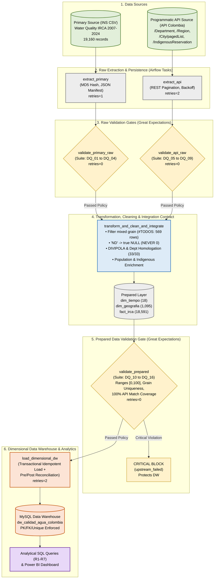
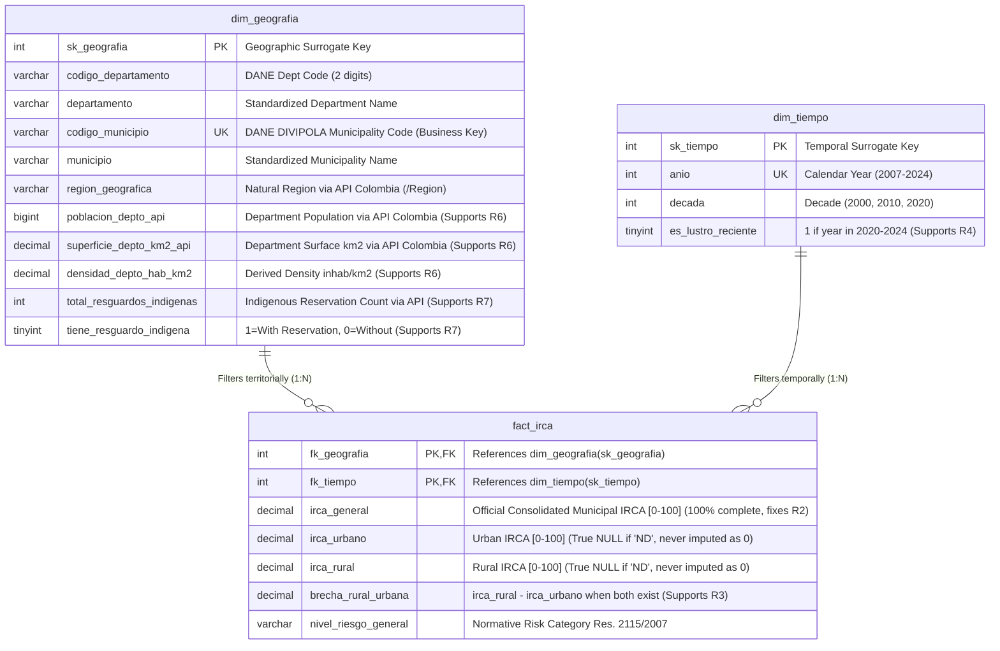

# ETL Project - Second Delivery: Pipeline Automation, API Integration, and Data Quality Validation

> **Engineering Principle:** *A Data Engineer does not build scripts. A Data Engineer designs systems.*
>
> 🇪🇸 **Versión en Español:** Puedes consultar la documentación completa en español en [README_es.md](README_es.md).

---

## 1. Colombian Problem and Analytical Objective

* **Project Title:** Operational Data Engineering System for Dimensional Analysis of Drinking Water Inequality (IRCA), Demographic Exposure, and Vulnerability in Indigenous Territories in Colombia.
* **Selected SDG:** **SDG 6 – Clean Water and Sanitation** (Target 6.1: Achieve universal and equitable access to safe and affordable drinking water for all; Target 6.b: Support and strengthen the participation of local communities in improving water and sanitation management).
* **Colombian Problem:** Colombia faces a deep structural gap in safe drinking water access between major urban centers, dispersed rural areas, and ethnic/indigenous territories. While primary capital cities report **IRCA (Water Quality Risk Index for Human Consumption)** levels within the *"No Risk"* band ($0\% - 5\%$), hundreds of peripheral and rural municipalities consume water categorized as *"Medium Risk"* ($14.1\% - 35\%$), *"High Risk"* ($35.1\% - 80\%$), or *"Sanitarily Unviable"* ($80.1\% - 100\%$).
* **Second Delivery Analytical Objective:** Evolve the analytical baseline from the First Delivery into an automated, auditable, and fault-tolerant data engineering system that integrates historical water quality measurements from the **National Institute of Health (INS)** with demographic, territorial, and **Indigenous Reservation** data programmatically extracted from **API Colombia**, automating data-quality validation across **3 explicit gates with Great Expectations**, performing idempotent loads into a **MySQL Data Warehouse**, and orchestrating the complete lifecycle with **Apache Airflow 3.1.8**.
* **Principal Stakeholders:** Ministry of Health and Social Protection, Ministry of Housing, City and Territory, Superintendency of Residential Public Services (SSPD), National Institute of Health (INS), Departmental Governorates, Municipal Mayoralties, and Indigenous Reservation Authorities.

---

## 2. First Delivery Baseline and Repository Link

* **First Delivery Repository (Preserved intact as mandatory baseline):** [https://github.com/Big2Welker/Project1ETLSVG](https://github.com/Big2Welker/Project1ETLSVG)
* **Baseline Summary (First Delivery):**
  In the First Delivery, we built a modular Python pipeline that extracted the historical INS CSV dataset (`Calidad_del_Agua_para_Consumo_Humano_en_Colombia_20260905.csv`), filtered out departmental subtotals (`#TODOS`), structured a baseline Star Schema (`dim_tiempo`, `dim_geografia`, `fact_irca`), and loaded it into MySQL to answer analytical requirements **R1 through R5**.
* **Critical Limitation Identified in First Delivery Review (Instructor Feedback):**
  In analytical query **R2** of the First Delivery, the expression `AVG((COALESCE(f.irca_urbano, 0) + COALESCE(f.irca_rural, 0)) / 2)` was used. Under Colombia's official IRCA scale (Resolution 2115 of 2007), **$0\%$ represents "No Risk" (100% safe drinking water)**. Because $51.3\%$ of municipal records (`9,538` rows) have `IRCArural = 'ND'` (`NULL`), replacing missing values with `0` artificially cut the risk average in half for entire departments (e.g., Chocó dropped from a true risk of **$50.83\%$** to a biased score of **$25.41\%$**) and distorted the national Top 5 ranking.

### Prior Dimensional Model (First Delivery Baseline)


---

## 3. Status and Change Decisions for R1–R5 (Continuity)

| Requirement | Status | Change Introduced | Analytical and Design Justification | Second Delivery Analytical Output |
| :--- | :--- | :--- | :--- | :--- |
| **R1** (Historical national IRCA evolution since 2007) | **Refine** | Added the official consolidated municipal indicator `irca_general` alongside `irca_urbano` and `irca_rural`, computing `AVG()` strictly over valid non-null measurements (`NULL` ignored natively). | Enables comparing the overall national trajectory ($28.20\%$ in 2007 $\rightarrow$ $10.72\%$ in 2024) against urban and rural trends without missing-value distortion. | Triple line chart (General, Urban, and Rural IRCA 2007–2024) and national historical reduction KPI. |
| **R2** (Identify Top 5 departments with the worst current water quality) | **Refine (Critical Fix)** | **Removed** `COALESCE(irca, 0)` completely. Ranking now evaluates the official `irca_general` attribute in `fact_irca`, while reporting true urban and rural averages in parallel. | **Direct fix for instructor feedback:** Imputing `0` falsely assumed optimal water in `8,968` records where one zone was `'ND'`. With this fix, the true 2024 Top 5 is **Chocó ($50.83\%$)**, **Guainía ($32.80\%$)**, **Cesar ($22.09\%$)**, **Nariño ($20.31\%$)**, and **Bolívar ($19.10\%$)** (replacing distorted entries like Caldas and Risaralda). | Horizontal bar chart for Top 5 Critical Departments (2024) + Before/After bias comparison table. |
| **R3** (Compare water risk between urban and rural zones per department) | **Refine** | Added derived measure `brecha_rural_urbana` in `fact_irca` and guarded DAX/SQL formulas so the gap is computed **only** when both zones have real measurements (`irca_rural IS NOT NULL AND irca_urbano IS NOT NULL`). | Prevents subtracting against artificial zeros (which previously produced false negative spikes like `-43.83` in Chocó) and isolates true intra-departmental inequality. | Horizontal bar chart of Rural–Urban Risk Gap by Department. |
| **R4** (Detect municipalities in constant "High Risk" over the last 5 years) | **Refine** | Added `es_lustro_reciente` in `dim_tiempo` (2020–2024) and official DANE DIVIPOLA `codigo_municipio` in `dim_geografia`, evaluating `irca_general > 35 OR irca_rural > 35` across all 5 consecutive years. | Prevents collisions across homonymous municipalities in different departments (e.g., *Armenia*, *Albania*, *Sucre*, *Córdoba*) and captures municipalities lacking rural disaggregation but having critical general IRCA. | Surveillance table of the **65 chronic high-risk municipalities**, led by Zaragoza ($74.66\%$) and Roncesvalles ($72.76\%$). |
| **R5** (Departments that reduced rural water risk the most over time) | **Maintain** | Preserved the `MIN(anio)` (2007) vs. `MAX(anio)` (2024) delta over `AVG(irca_rural)` with explicit `IS NOT NULL` filters at both endpoints and dedicated DAX measure `Progreso Rural 2007 vs 2024 (R5)`. | The requirement remains analytically sound and highlights public policy success stories (led by Guaviare with $-87.10$ points and Huila with $-52.33$ points). | Dedicated horizontal bar chart of Net Rural IRCA Reduction ($\Delta$ 2007 vs. 2024). |

---

## 4. New Integrated Analytical Requirements (R6 and R7)

Each new requirement strictly combines attributes from both the **Primary Source (INS CSV)** and the **Secondary API Source (API Colombia)**:

| ID | Analytical Requirement | Primary-Source Data Required (INS CSV) | API Data Required (API Colombia) | Integration Strategy or Key | Expected KPI or Measure | Required Level of Detail (Grain) |
| :--- | :--- | :--- | :--- | :--- | :--- | :--- |
| **R6** | **Departmental Demographic Exposure to Water Risk & Territorial Density:** Quantify the estimated departmental population exposed to medium/high water risk ($\text{IRCA} > 14\%$) and analyze its relationship with population density and natural region. | `Departamento`, `DepartamentoCodigo`, `MunicipioCodigo`, `Año`, `IRCA` (`irca_general`). | `/api/v1/Department`: `name`, `population`, `surface`, `regionId`.<br>`/api/v1/Region`: `id`, `name`. | Diacritic/case normalization + explicit departmental homologation dictionary (`depto_norm`) enriching `dim_geografia` ($100\%$ coverage: 33/33 departments). | **KPI 1:** Estimated Population Exposed to Water Risk ($\text{Pop}_{\text{API}} \times \frac{\text{Mpios}_{\text{IRCA}>14\%}}{\text{Mpios}_{\text{Eval}}}$).<br>**KPI 2:** Demographic Density ($\text{inhab/km}^2$) vs. Consolidated IRCA. | Departmental and Natural Region level for the latest annual cut (2024). |
| **R7** | **Water Vulnerability Gap in Municipalities with Indigenous Reservations:** Determine whether municipalities with Indigenous Reservations experience higher rural and general water risk than the rest of the country, identifying critical indigenous territories. | `Departamento`, `Municipio`, `MunicipioCodigo`, `Año`, `IRCA`, `IRCArural`, `Nivel de riesgo`. | `/api/v1/IndigenousReservation/pagedList`: `id`, `name`, `code`, `city` (`name`), `department` (`name`).<br>`/api/v1/City/pagedList`. | Aggregation of reservation counts per normalized composite key `(depto_norm, mpio_norm)` integrated into `dim_geografia` (`total_resguardos_indigenas`, `tiene_resguardo_indigena`). | **KPI 1:** Historical Rural IRCA Gap in Municipalities With Reservations ($42.14\%$) vs. Without Reservations ($37.31\%$ $\rightarrow +4.83$ pts).<br>**KPI 2:** Top 10 Critical Indigenous Municipalities. | Municipal and Territorial Indigenous Condition level (2007–2024 series and 2024 cut). |

---

## 5. Primary Source and API Source (Suitability and Technical Documentation)

### 5.1 Primary Source
* **Provider:** National Institute of Health (INS) – SIVICAP / Colombian Open Data Portal (`datos.gov.co`).
* **File:** [data/raw/primary/Calidad_del_Agua_para_Consumo_Humano_en_Colombia_20260905.csv](data/raw/primary/Calidad_del_Agua_para_Consumo_Humano_en_Colombia_20260905.csv) (`19,160` raw rows; `18,591` atomic municipal rows after isolating `569` `#TODOS` subtotal rows).

### 5.2 API Suitability and Technical Documentation (Section 4.1)

| Item | Required Technical Documentation |
| :--- | :--- |
| **Provider and purpose** | **API Colombia** (`https://api-colombia.com/api/v1`), an open RESTful web service providing standardized public data on Colombia's political-administrative division, departmental/municipal demographics, natural regions, and legally registered indigenous reservations. |
| **Analytical value (Section 6)** | The primary INS CSV only contains water quality risk percentages (IRCA) and **completely lacks population figures, territorial surface area ($\text{km}^2$), natural regions, and indigenous reservation presence**. Without the API, it is impossible to determine whether a high IRCA score affects 50,000 or 2,200,000 inhabitants (R6), or to prioritize water sanitation in municipalities with indigenous communities (R7). |
| **Endpoints and parameters** | 1. `GET /api/v1/Department` (Full list of 33 departments with `population`, `surface`, `regionId`).<br>2. `GET /api/v1/Region` (Full list of 6 natural regions).<br>3. `GET /api/v1/City/pagedList?Page={p}&PageSize=200` (Paginated catalog of 1,123 municipalities).<br>4. `GET /api/v1/IndigenousReservation/pagedList?Page={p}&PageSize=200` (Paginated catalog of 829 indigenous reservations). |
| **Response and retained attributes** | `application/json` (UTF-8). Paginated endpoints return envelope `{"page", "pageSize", "totalRecords", "pageCount", "data": [...]}`. Retained attributes: `Department` (`id`, `name`, `population`, `surface`, `regionId`), `Region` (`id`, `name`), `IndigenousReservation` (`id`, `name`, `code`, `cityId`, `city.name`, `department.name`). |
| **Authentication and Security** | Public REST API over HTTPS (no secret token required). Base URL, timeouts, page sizes, and MySQL credentials are externalized via environment variables in `.env` (template provided in [.env.example](.env.example); secrets are strictly excluded via [.gitignore](.gitignore)). |
| **Operational behavior** | Implemented in [src/extract_api.py](src/extract_api.py): automated pagination loop (`Page=1..pageCount`), polite `0.15s` rate-limit delay between requests, `25s` HTTP timeout, and bounded retry with exponential backoff (`max_retries=3`). Persists raw JSON batches and audit manifest `api_manifest_{batch_id}.json`. |
| **Reproducibility** | Any evaluator can execute `python src/extract_api.py` or trigger the `extract_api` task in Airflow to run live HTTP requests and inspect the persisted raw payloads in `data/raw/api/`. |

---

## 6. Analytical Value Contributed by the API & Attribute Mapping

| Attribute | Source | Raw Endpoint / Column | Downstream Use in System | Supported Requirement |
| :--- | :--- | :--- | :--- | :--- |
| `codigo_municipio`, `codigo_departamento` | Primary Source (INS CSV) | `MunicipioCodigo`, `DepartamentoCodigo` | Unique Business Key (`UNIQUE`) in `dim_geografia` and disambiguation key for homonymous municipalities. | R1–R7 |
| `irca_general`, `irca_urbano`, `irca_rural` | Primary Source (INS CSV) | `IRCA`, `IRCAurbano`, `IRCArural` | Fact measures in `fact_irca`. `irca_general` resolves the R2 bias; `irca_urbano` and `irca_rural` preserve true SQL `NULL`s. | R1–R7 |
| `region_geografica` | Secondary Source (API Colombia) | `GET /api/v1/Region` (`name`) | Hierarchical spatial attribute in `dim_geografia` grouping departments into Colombia's 6 Natural Regions. | R2, R4, R6, R7 |
| `poblacion_depto_api`, `superficie_depto_km2_api` | Secondary Source (API Colombia) | `GET /api/v1/Department` (`population`, `surface`) | Demographic context in `dim_geografia` and basis for `densidad_depto_hab_km2` and exposed population estimation. | R6 |
| `total_resguardos_indigenas`, `tiene_resguardo_indigena` | Secondary Source (API Colombia) | `GET /api/v1/IndigenousReservation/pagedList` | Reservation count and boolean flag (`1/0`) in `dim_geografia` to segment rural water risk across indigenous territories. | R7 |

---

## 7. System Architecture (Section 22)

*(Also available in [docs/ETL_Architecture.md](docs/ETL_Architecture.md))*



---

## 8. Data Profiling Findings (Section 7)

Reproducible profiling code is provided in both an interactive Jupyter Notebook ([notebooks/data_profiling.ipynb](notebooks/data_profiling.ipynb)) and a standalone script ([notebooks/data_profiling.py](notebooks/data_profiling.py)), with structured output persisted in [docs/evidence/profiling_summary.json](docs/evidence/profiling_summary.json). **Profiling strictly observes and produces evidence without modifying source data:**

| Dataset or Attribute | Quantitative Profiling Evidence | Potential Quality Risk | Related Requirement |
| :--- | :--- | :--- | :--- |
| **Primary CSV:** `Municipio = '#TODOS'` | Out of `19,160` total CSV rows, exactly **`569` rows ($2.97\%$)** are departmental summary rows (`#TODOS`) and **`18,591` rows** are atomic municipal records. | **Mixed Granularity (Double Counting):** Keeping `#TODOS` in the Fact Table distorts departmental and national averages. | R1–R7 |
| **Primary CSV:** Covert `'ND'` nulls in `IRCA`, `IRCAurbano`, `IRCArural` | Across the `18,591` municipal rows: `IRCA` (consolidated) has **`0` `'ND'` ($0.0\%$)**; `IRCAurbano` has **`1,264` `'ND'` ($6.8\%$)**; `IRCArural` has **`9,538` `'ND'` ($51.3\%$)**. Overall, **`8,968` rows ($48.24\%$)** have a valid measurement in one zone but `'ND'` in the other. | **Zero-Imputation Bias (Delivery 1 R2 Error):** Converting `'ND'` to `0` assumes "No Risk" ($0\%$) and artificially halves the risk score across `8,968` records (e.g., Zaragoza drops from $96.5\%$ to $48.25\%$). | R1, R2, R3, R4, R5, R7 |
| **Primary CSV:** Candidate Key Uniqueness & Homonyms | Evaluating `(MunicipioCodigo, Año)` yields **`0` duplicates** across `18,591` rows. However, evaluating `(Municipio, Año)` without department or DANE code produces **`1,383` duplicate collisions**. | **Homonymous Municipality Collision:** Grouping or joining solely by municipality name merges distinct towns sharing the same name (e.g., *Armenia*, *Albania*, *Sucre*, *Córdoba*). | R4, R7 |
| **API Colombia:** `/api/v1/Department` vs. `/api/v1/City/pagedList` | `/Department` returns **`33` records** with **`0` nulls ($100\%$ completeness)** in `population` and `surface`. Conversely, `/City` returns **`1,123` municipalities**, but **only `63` have non-null `population` (`1,060` nulls = $94.39\%$ missing)**. | **Severe Municipal Population Incompleteness in API:** Using `City.population` would leave $94.39\%$ of municipalities with `NULL` population. This evidence justifies sourcing population at the `/Department` level ($100\%$ complete) for R6. | R6 |
| **API Colombia:** `/api/v1/IndigenousReservation/pagedList` | Returns **`829` indigenous reservations** across 5 pages (`0` nulls in `cityId`, `city`, and `department`), distributed across **`232` unique municipalities**. The raw JSON schema exhibits an upstream typo in field `"deparmentId"` (missing `'t'`), while nested objects `"department"` and `"city"` are intact. | Schema extraction failure if referencing flat `"departmentId"` instead of the nested `"department"` and `"city"` objects. | R7 |
| **Cross-Source Compatibility (`INS CSV` $\leftrightarrow$ `API Colombia`)** | The CSV contains **34 distinct `Departamento` strings** because San Andrés appears with both uppercase `"Y"` (2024) and lowercase `"y"` (2007–2023). After stripping accents, **31 departments match exactly** and **2 require explicit mapping**: `"BOGOTA, D.C."` $\leftrightarrow$ `"BOGOTA"` and `"ARCHIPIELAGO DE SAN ANDRES..."` $\leftrightarrow$ `"SAN ANDRES Y PROVIDENCIA"`. | **Unmatched Integration Records:** A naive string join without normalization and homologation would drop Bogotá and San Andrés in R6 and major capitals like Cartagena de Indias or Cúcuta in R7. | R6, R7 |

---

## 9. Quality Risks, Data Rules (DQ Rules), and Severity Policy (Section 8)

We defined **16 explicit quality rules (`DQ_01` through `DQ_16`)** across all 3 validation gates:

| Rule ID | Source or Layer | Attribute(s) | Quality Dimension | Explicit Quality Rule | Metric & Justified Threshold | Severity | Related Requirement |
| :--- | :--- | :--- | :--- | :--- | :--- | :--- | :--- |
| **DQ_01** | Primary Raw (`Gate 1`) | CSV Table | Completeness & Volume | Primary batch must contain the complete multi-year national series (18 years $\times \sim 1,050$ municipalities). | `row_count` $\in [15,000,\ 25,000]$ (Observed: `19,160`). Based on SIVICAP historical reporting coverage. | **Critical** | R1–R7 |
| **DQ_02 – DQ_03** | Primary Raw (`Gate 1`) | `IRCA`, `MunicipioCodigo` | Completeness | Consolidated `IRCA` and official DANE code `MunicipioCodigo` must never be null in raw input. | `null_count == 0` ($100\%$ completeness required on primary measure and key). | **Critical** | R1, R2, R4 |
| **DQ_04** | Primary Raw (`Gate 1`) | `Municipio` | Validity (Domain) | Monitor proportion of departmental subtotal rows (`#TODOS`) prior to cleaning. | `mostly >= 0.95` rows not in `['#TODOS']` (Observed: $97.03\%$ atomic rows). | **Warning** | R1–R5 |
| **DQ_05** | API Raw (`Gate 2`) | `/Department` | Completeness & Contract | Department endpoint must return all constitutional territorial units of Colombia. | `row_count == 33` (32 departments + Capital District). | **Critical** | R6 |
| **DQ_06 – DQ_07** | API Raw (`Gate 2`) | `population`, `surface` | Validity & Range | Departmental population and surface area from the API must be non-null and strictly positive. | `population` $\in [10,000,\ 15,000,000]$ and `surface` $\in [10,\ 200,000]\ \text{km}^2$ (`0` nulls). | **Critical** | R6 |
| **DQ_08** | API Raw (`Gate 2`) | `/IndigenousReservation` (`cityId`) | Completeness | Every extracted indigenous reservation must reference a valid municipal `cityId`. | `null_count(cityId) == 0` and `row_count >= 500` (Observed: `829`). | **Critical** | R7 |
| **DQ_09** | API Raw (`Gate 2`) | `/City` | Completeness | Operational volume check on municipal catalog from API Colombia. | `row_count` $\in [1,100,\ 1,200]$ (Observed: `1,123` municipalities). | **Informational** | R6, R7 |
| **DQ_10 – DQ_12** | Prepared Data (`Gate 3`) | `irca_general`, `irca_urbano`, `irca_rural` | Validity (Range) | All numeric IRCA values (including non-null urban and rural scores) must obey the legal Resolution 2115/2007 domain. | Values $\in [0.0,\ 100.0]$ ($0\%$ to $100\%$). Any value $<0$ or $>100$ is physically invalid. | **Critical** | R1–R7 |
| **DQ_13** | Prepared Data (`Gate 3`) | `(fk_geografia, fk_tiempo)` | Uniqueness (Fact Grain) | Strict compound uniqueness of the declared grain in `fact_irca`. | `duplicate_count == 0` ($100\%$ unique across `18,591` municipal-year rows). | **Critical** | R1–R7 |
| **DQ_14 – DQ_16** | Prepared Data (`Gate 3`) | `dim_geografia` (`codigo_municipio`, `poblacion_depto_api`, `municipio`) | Uniqueness & Integration Consistency | Uniqueness of DIVIPOLA code, $100\%$ departmental population match from API Colombia, and zero remaining `#TODOS` rows. | `unique(codigo_municipio) == 100%`, `poblacion_depto_api > 10,000` across all `1,095` municipalities, and `0` `'#TODOS'` rows. | **Critical** | R1–R7 |

### Severity and Pipeline Policy (Section 8.1)
* **Critical:** Makes normal continuation unsafe. The validation task raises a `RuntimeError`, transitions the Airflow Task Instance to `failed`, and **blocks all dependent downstream tasks (`upstream_failed`)**, preventing any corrupt load into the MySQL Data Warehouse.
* **Warning:** Records known raw-layer anomalies (such as the $2.97\%$ `#TODOS` rows in `DQ_04`) in the Great Expectations JSON evidence (`CONTINUE_WITH_WARNING_LOGGED`) and allows execution to proceed to the transformation layer that resolves them.
* **Informational:** Supports trend and catalog monitoring (`DQ_09`) without blocking execution.

---

## 10. Automated Validation with Great Expectations (Sections 9, 10, 11, and 14)

Implemented in [gx/gx_validation.py](gx/gx_validation.py) using **Great Expectations 1.24.0**:

| GX Element | System Implementation and Explanation |
| :--- | :--- |
| **Data Object** | `DataFrameAsset` bound to an ephemeral GX context (`gx.get_context(mode="ephemeral")`) via `add_pandas` and `add_batch_definition_whole_dataframe` for each evaluated dataset (`primary_raw_csv`, `api_depts_raw`, `api_indig_raw`, `prepared_fact_irca`, `prepared_dim_geografia`). |
| **Expectation** | Native `gx.expectations` classes (`ExpectTableRowCountToBeBetween`, `ExpectColumnValuesToNotBeNull`, `ExpectColumnValuesToNotBeInSet`, `ExpectColumnValuesToBeBetween`, `ExpectCompoundColumnsToBeUnique`, `ExpectColumnValuesToBeUnique`), each mapped to its `rule_id` (`DQ_01`–`DQ_16`). |
| **Expectation Suite** | Organized into **3 explicit validation gates**:<br>1. **Gate 1 (`validate_primary_raw_gate`):** `suite_primary_raw`<br>2. **Gate 2 (`validate_api_raw_gate`):** `suite_api_departments_raw`, `suite_api_indigenous_raw`, `suite_api_cities_raw`<br>3. **Gate 3 (`validate_prepared_gate`):** `suite_prepared_fact_irca`, `suite_prepared_dim_geografia` |
| **Validation Definition & Execution** | `gx.ValidationDefinition(name=..., data=batch_def, suite=suite).run(batch_parameters={"dataframe": df})` invoked deterministically by each Airflow validation task. |
| **Validation Result & Pipeline Response** | Persists structured JSON evidence in `docs/evidence/gx_gate{1,2,3}_*.json` containing `observed_value`, `element_count`, `unexpected_count`, `unexpected_percent`, and `pipeline_action` (`PROCEED_NORMAL` or `BLOCK_DW_LOAD_CRITICAL_FAILURE`). |

---

## 11. Transformation Strategy and Integration Contract (Sections 13 and 13.1)

Implemented in [src/transform_integrate.py](src/transform_integrate.py).

### 11.1 Significant Transformations Log

| Transformation ID | Rule or Engineering Rationale | Affected Fields | Before and After Behavior | Exception Handling | Analytical or Dimensional Impact |
| :--- | :--- | :--- | :--- | :--- | :--- |
| **T01** | Isolate atomic municipal grain by removing departmental subtotal rows. | `Municipio`, `MunicipioCodigo` | **Before:** `19,160` rows (includes `569` `#TODOS` rows).<br>**After:** `18,591` strictly municipal rows. | Exact excluded row count (`excluded_todos_rows = 569`) is logged in the reconciliation artifact. | Preserves atomic grain in `fact_irca` and prevents double counting. |
| **T02** | **Critical Fix for R2:** Convert `'ND'` to true `NULL` (`np.nan` $\rightarrow$ SQL `NULL`) and retain `irca_general` without imputing `0`. | `IRCA`, `IRCAurbano`, `IRCArural` | **Before:** Strings with comma decimals (`"14,8"`) and `"ND"` (`9,538` rural; `1,264` urban).<br>**After:** `DECIMAL(6,2)` with true `NULL` when unmeasured. | Unparseable strings coerce to `np.nan` and are checked in `Gate 3`. | Eliminates the artificial zero-bias across `8,968` rows and restores the true R2 departmental ranking. |
| **T03** | Standardize DANE DIVIPOLA codes and parse calendar year. | `DepartamentoCodigo`, `MunicipioCodigo`, `Año` | **Before:** `"5"`, `"5001"`, `"2,024"`.<br>**After:** `"05"`, `"05001"` (5-digit padded string), `2024` (`INT`). | `zfill(2)` and `zfill(5)` enforce canonical code lengths. | Enables `codigo_municipio` as a `UNIQUE` Business Key in `dim_geografia` (`1,095` municipalities). |
| **T04** | Derive `brecha_rural_urbana` and official risk classification (Res. 2115/2007). | `brecha_rural_urbana`, `nivel_riesgo_general` | **Before:** No precomputed gap.<br>**After:** `irca_rural - irca_urbano` computed only when both zones are `NOT NULL`. | If either zone is `NULL`, `brecha_rural_urbana` remains `NULL` (never subtracts `0`). | Supports accurate intra-departmental inequality analysis in R3. |
| **T05** | Harmonize and integrate **API Colombia** attributes (Departments, Regions, Indigenous Reservations). | `region_geografica`, `poblacion_depto_api`, `densidad_depto_hab_km2`, `total_resguardos_indigenas` | **Before:** Dimensions lacked demographic and ethnic context.<br>**After:** `dim_geografia` enriched across all `1,095` municipalities. | Explicit homologation dictionaries (`DEPT_HOMOLOGATION_MAP`, `CITY_HOMOLOGATION_MAP`) + NFD normalization. | Enables integrated requirements R6 and R7 directly over the Star Schema. |

### 11.2 Integration Contract (Section 13.1)

| Contract Element | Engineering Decision and Empirical Evidence |
| :--- | :--- |
| **Integration key or keys** | 1. **Departmental Level (`CSV` $\leftrightarrow$ `API /Department`):** Normalized key `depto_norm` (uppercase, NFD accent-stripped + homologation dictionary).<br>2. **Municipal Indigenous Level (`CSV` $\leftrightarrow$ `API /IndigenousReservation`):** Normalized composite key `(depto_norm, mpio_norm)`. |
| **Cardinality** | • `API Department (1) : (N) Municipalities in dim_geografia` (33 departments enrich 1,095 municipalities).<br>• `Municipality in dim_geografia (1) : (0..N) Reservations in API IndigenousReservation` (pre-aggregated by municipality as `total_resguardos_indigenas` to maintain a `1:1` grain with `dim_geografia`). |
| **Preprocessing** | `normalize_key()` strips diacritics (`NFD`), punctuation, and extra whitespace. `DEPT_HOMOLOGATION_MAP` unifies both CSV variants of San Andrés (`"... Y Santa Catalina"` and `"... y Santa Catalina"`) into `"SAN ANDRES Y PROVIDENCIA"`, and `"BOGOTA, D.C."` into `"BOGOTA"`. `CITY_HOMOLOGATION_MAP` aligns official city names (e.g., `"CARTAGENA DE INDIAS"` $\rightarrow$ `"CARTAGENA"`, `"SAN JOSE DE CUCUTA"` $\rightarrow$ `"CUCUTA"`). |
| **Temporal alignment** | Primary CSV covers annual measurements `2007–2024`. The API provides current structural demographic and reservation records. In R6, demographic exposure is evaluated strictly against the latest annual cut (`anio = 2024`); in R7, reservation presence acts as a conformed territorial classification in `dim_geografia`. |
| **Unmatched records** | • **Departments:** **0 unmatched ($100.0\%$ match coverage:** all `1,095` municipalities in `dim_geografia` receive population, surface area, density, and region).<br>• **Indigenous Reservations:** Out of `232` unique municipalities in the API, **`207` municipalities ($89.2\%$)** match municipalities monitored by INS SIVICAP; the remaining `25` correspond to unmunicipalized areas or municipalities without historical INS water reports. Municipalities without reservations receive `total_resguardos_indigenas = 0`. |
| **Duplicate or ambiguous matches** | Because Colombia has homonymous municipalities across different departments (`1,383` collisions found in profiling if using municipality name alone), **joining on municipality name alone is prohibited**. Matching strictly enforces the composite key `(depto_norm, mpio_norm)` and unique `codigo_municipio`. |
| **Assumptions and Limitations** | **Assumption:** The proportion of municipalities with $\text{IRCA} > 14\%$ in a department reflects departmental population exposure (R6).<br>**Documented Limitation:** Because `/api/v1/City` has $94.39\%$ nulls in `population`, population exposure cannot be reliably disaggregated to individual municipalities from this API alone; therefore R6 is rigorously formulated at the departmental level where API completeness is $100\%$. |

---

## 12. Refined Dimensional Model and Change Justification (Section 12)

*(Also available in [docs/Star_Schema.md](docs/Star_Schema.md) and implemented in [sql/create_dw.sql](sql/create_dw.sql))*



### Dimensional Model Review & Change Justification
1. **Business Process & Grain Declaration:** *"One row in `fact_irca` represents the consolidated annual measurement of the Drinking Water Quality Risk Index (general, urban, rural, and rural–urban gap) for a specific Colombian municipality in a specific calendar year."*
2. **Why the API Enriches `dim_geografia` Instead of Creating a Separate Fact Table:** The attributes supplied by `API Colombia` (natural region, static departmental population/surface, and number of indigenous reservations located in the municipality) are **structural spatial attributes of the territory**. Enriching `dim_geografia` as a conformed spatial dimension allows slicing, grouping, and weighting `fact_irca` measurements across R1–R7 without violating or mixing the municipal-annual grain of the Fact Table.

---

## 13. Data Warehouse Implementation and Load Reconciliation (Section 15)

Implemented in [src/load_dw.py](src/load_dw.py) on **MySQL 8.0** (`dw_calidad_agua_colombia`).
* **Reconciliation Evidence ([docs/evidence/dw_load_reconciliation_test_A_success.json](docs/evidence/dw_load_reconciliation_test_A_success.json)):**
  * Raw CSV input rows: `19,160` $-$ Excluded `#TODOS` rows: `569` $=$ Expected atomic rows: **`18,591`**.
  * `dim_tiempo`: **`18` prepared rows** $=$ **`18` loaded rows** in MySQL (2007–2024).
  * `dim_geografia`: **`1,095` prepared rows** $=$ **`1,095` loaded rows** in MySQL.
  * `fact_irca`: **`18,591` prepared rows** $=$ **`18,591` loaded rows** in MySQL.
  * Preserved true `NULL`s in `fact_irca.irca_rural`: **`9,538` records** (matching the exact `'ND'` count from raw profiling).

---

## 14. Apache Airflow 3.1.8 Orchestration, Task Interfaces, and Failure/Retry Policies (Sections 16–19)

The workflow is orchestrated in [dags/etl_irca_api_dag.py](dags/etl_irca_api_dag.py) using the mandatory TaskFlow public authoring interface:
```python
from airflow.sdk import dag, task
```

### 14.1 Task Interfaces (No Bulk XCom Transport - Section 17)

| Airflow Task (`task_id`) | Input Contract | Output Contract (Compact XCom Reference) | Batch Identity | Failure Signal |
| :--- | :--- | :--- | :--- | :--- |
| `extract_primary` | Primary CSV path & `test_scenario` param. | `{batch_id, scenario, primary_csv_path, raw_row_count}` + JSON manifest with MD5 hash. | `batch_id` + `file_md5` | `FileNotFoundError` |
| `extract_api` | `API_COLOMBIA_BASE_URL` & `test_scenario` param. | `{batch_id, scenario, api_raw_dir, departments_extracted, cities_extracted, indigenous_extracted}` + raw JSON files. | `batch_id` + `extraction_timestamp_utc` | `RuntimeError` after exhausting HTTP retries. |
| `validate_primary_raw` | Compact reference from `extract_primary`. | `{batch_id, scenario, primary_csv_path, gate1_action, critical_failures}` + GX Gate 1 JSON. | `batch_id` | `RuntimeError` if `critical_failures > 0`. |
| `validate_api_raw` | Compact reference from `extract_api`. | `{batch_id, scenario, api_raw_dir, gate2_action, critical_failures}` + GX Gate 2 JSON. | `batch_id` | `RuntimeError` if `critical_failures > 0`. |
| `transform_and_clean_and_integrate` | Validated references from `validate_primary_raw` and `validate_api_raw`. | `{batch_id, scenario, prepared_dir, fact_irca_rows, dim_geografia_rows}` + prepared CSVs. | `batch_id` | Exception on transformation error. |
| `validate_prepared` | Compact reference from `transform_and_clean_and_integrate`. | `{batch_id, prepared_dir, gate3_action, critical_failures}` + GX Gate 3 JSON. | `batch_id` | `RuntimeError` if `critical_failures > 0` (**Blocks `load_dimensional_dw`**). |
| `load_dimensional_dw` | Validated reference from `validate_prepared`. | `{batch_id, database, post_load_counts, reconciliation_passed}` + MySQL audit row. | `batch_id` in `etl_batch_audit` | `AssertionError` / `SQLAlchemyError` (Transactional Rollback). |

### 14.2 Selective Failure Handling and Retry Policy (Section 18)

| Condition / Task | Failure Class | Pipeline Response | Retry Configuration | Engineering Justification |
| :--- | :--- | :--- | :--- | :--- |
| Temporary HTTP timeout or rate-limit in `extract_api` | **Transient Operational Failure** | Retry with exponential backoff; fail branch only if all attempts fail. | `retries=2`, `retry_delay=30s` (plus internal 3-attempt HTTP backoff) | Live testing against API Colombia showed occasional transient socket timeouts across multi-page extraction that succeed on subsequent attempts. |
| Temporary database lock or connection drop in `load_dimensional_dw` | **Transient Operational Failure** | Rollback active SQL transaction and retry cleanly. | `retries=2`, `retry_delay=30s` | Transient container network blips recover on retry, and transactional delete-and-reload guarantees zero partial state. |
| Critical GX Rule violation in `validate_primary_raw`, `validate_api_raw`, or `validate_prepared` | **Deterministic Data or Contract Failure** | **Stop immediately (`failed`)**, preserve Great Expectations JSON evidence, and block downstream tasks (`upstream_failed`). | **`retries=0`** | Automatically re-running the exact same corrupt batch (e.g., `irca_general = 145.0` or null primary keys) deterministically reproduces the failure. |

---

## 15. Mandatory Reliability Tests Evidence (Section 20)

All three mandatory reliability tests were executed both via the CLI test runner ([src/main.py](src/main.py)) and inside the **Apache Airflow 3.1.8** container environment, with complete evidence preserved in [docs/evidence/reliability_tests_summary.json](docs/evidence/reliability_tests_summary.json):

### 15.1 Test A: Successful Run (`batch_id = test_A_success` & `airflow_normal_success`)
* **Outcome:** All 7 tasks in the DAG completed in state **`success`**.
* **Preserved Evidence:**
  * Gate 1 Primary Raw: [docs/evidence/gx_gate1_primary_raw_test_A_success.json](docs/evidence/gx_gate1_primary_raw_test_A_success.json) (`0` critical failures $\rightarrow$ `PROCEED_NORMAL`).
  * Gate 2 API Raw: [docs/evidence/gx_gate2_api_raw_test_A_success.json](docs/evidence/gx_gate2_api_raw_test_A_success.json) (`0` critical failures $\rightarrow$ `PROCEED_NORMAL`).
  * Gate 3 Prepared Data: [docs/evidence/gx_gate3_prepared_test_A_success.json](docs/evidence/gx_gate3_prepared_test_A_success.json) (`0` critical failures $\rightarrow$ `PROCEED_TO_DW_LOAD`).
  * MySQL DW Load Reconciliation: [docs/evidence/dw_load_reconciliation_test_A_success.json](docs/evidence/dw_load_reconciliation_test_A_success.json) (`18` years, `1,095` municipalities, `18,591` facts loaded).

### 15.2 Test B: Controlled Critical Quality Failure (`test_B_critical_failure` & `airflow_fail_gate1_primary_null`)
* **Interactive Airflow Parameter Support:** The DAG includes a built-in parameter dropdown (`test_scenario`) allowing live execution of controlled failures in Gate 1 (`fail_gate1_primary_null`), Gate 2 (`fail_gate2_api_negative_pop`), or Gate 3 (`fail_gate3_prepared_range` / `fail_gate3_duplicate_grain`).
* **Controlled Condition Evaluated:** In `test_B_critical_failure`, `fact_irca.irca_general` was mutated to **`145.0%`** (violating Critical Rule **`DQ_10`**: legal domain $[0.0, 100.0]$). Additionally, in Airflow run `airflow_fail_gate1_primary_null_20261021_155758`, nulls were injected into `IRCA` (violating Critical Rule **`DQ_02`**).
* **Observed Downstream Behavior:**
  * The affected validation task immediately transitioned to **`failed`** (`retries=0`), logging `unexpected_count` and the exact violated rule ID.
  * Downstream tasks (`load_dimensional_dw`) were automatically blocked in state **`upstream_failed (BLOCKED)`**, leaving the MySQL Data Warehouse untouched and uncorrupted.
* **Preserved Evidence:** [docs/evidence/gx_gate3_prepared_test_B_critical_failure.json](docs/evidence/gx_gate3_prepared_test_B_critical_failure.json) and [docs/evidence/gx_gate1_primary_raw_airflow_fail_gate1_primary_null_20261021_155758.json](docs/evidence/gx_gate1_primary_raw_airflow_fail_gate1_primary_null_20261021_155758.json).

### 15.3 Test C: Safe Rerun and Repeatability (`test_C_safe_rerun` & Consecutive Airflow Runs)
* **Selected Idempotency Strategy:** Transactional Delete-and-Reload in FK-safe order (`DELETE FROM fact_irca` $\rightarrow$ `DELETE FROM dim_geografia` $\rightarrow$ `DELETE FROM dim_tiempo` $\rightarrow$ validated insert inside an atomic `with engine.begin() as conn:` block) combined with database-level `PRIMARY KEY (fk_geografia, fk_tiempo)` and `UNIQUE (codigo_municipio)` constraints. If any failure occurs mid-load, MySQL rolls back the entire transaction automatically.
* **Before vs. After Rerun Comparison ([docs/evidence/dw_load_reconciliation_test_C_safe_rerun.json](docs/evidence/dw_load_reconciliation_test_C_safe_rerun.json) & [docs/evidence/dw_load_reconciliation_airflow_normal_success_20261023_000013.json](docs/evidence/dw_load_reconciliation_airflow_normal_success_20261023_000013.json)):**

| MySQL DW Control Metric | Before Rerun (`pre_load`) | After Rerun (`post_load`) | Delta ($\Delta$) |
| :--- | :---: | :---: | :---: |
| `dim_tiempo` row count | `18` | `18` | **`0` (No duplicates)** |
| `dim_geografia` row count | `1,095` | `1,095` | **`0` (No duplicates)** |
| `fact_irca` row count | `18,591` | `18,591` | **`0` (No duplicates)** |
| `AVG(irca_general)` | `21.2646` | `21.2646` | **`0.0000`** |
| `AVG(irca_urbano)` (ignoring NULLs) | `15.2412` | `15.2412` | **`0.0000`** |
| `AVG(irca_rural)` (ignoring NULLs) | `38.0794` | `38.0794` | **`0.0000`** |
| Preserved true `NULL`s in `irca_rural` | `9,538` | `9,538` | **`0`** |

---

## 16. Business Intelligence, Concrete Findings (R1–R7), and Integration Value (Section 21)

The Power BI file connected directly to the MySQL Data Warehouse is located at [docs/dashboard/dashboard.pbix](docs/dashboard/dashboard.pbix), backed by the SQL queries in [sql/analytical_queries.sql](sql/analytical_queries.sql) and exported results in [docs/evidence/analytical_results_r1_r7.json](docs/evidence/analytical_results_r1_r7.json).

### 16.1 Concrete Analytical Findings and Supported Decisions (Instructor Feedback Addressed)

1. **Finding R1 (National Historical Trend 2007–2024):**
   * **Concrete Values:** National consolidated IRCA dropped from **$28.20\%$** in 2007 (`994` evaluated municipalities) to **$10.72\%$** in 2024 (`1,006` municipalities), a net improvement of **$-17.48$ percentage points**. However, while the 2024 urban average reached **$8.79\%$** (Low Risk), the 2024 rural average remains at **$22.65\%$** (Medium Risk).
   * **Supported Decision:** Reallocate Departmental Water Plan (PDA) subsidies from already-stabilized urban capitals toward rural aqueducts.

2. **Finding R2 (Top 5 Critical Departments in 2024 & Proof of `COALESCE` Fix):**
   * **Concrete Values:** Removing `COALESCE(..., 0)` from Delivery 1 and evaluating `irca_general` reveals the true 2024 critical ranking:
     1. **Chocó (Pacific Region):** True IRCA = **$50.83\%$ (High Risk)** *(Delivery 1's `COALESCE` reported **$25.41\%$**, hiding half the risk because its rural records are `NULL`)*.
     2. **Guainía (Amazon Region):** True IRCA = **$32.80\%$ (Medium Risk)** *(Previously distorted to **$16.40\%$**)*.
     3. **Cesar (Caribbean Region):** True IRCA = **$22.09\%$** (Urban: $22.50\%$, Rural: $23.53\%$).
     4. **Nariño (Pacific Region):** True IRCA = **$20.31\%$** (Urban: $16.14\%$, Rural: **$37.41\%$**).
     5. **Bolívar (Caribbean Region):** True IRCA = **$19.10\%$** (Urban: $19.20\%$, Rural: $13.19\%$).
   * **Supported Decision:** Direct emergency sanitation funds from SSPD to Chocó, Guainía, and Cesar, eliminating the statistical blind spot that previously penalized departments with unmeasured rural zones.

3. **Finding R3 (Intra-Departmental Rural vs. Urban Inequality Gap):**
   * **Concrete Values:** The largest historical gaps (`AVG(irca_rural) - AVG(irca_urbano)`) occur in **Caldas** (**$+56.98$ points**: Urban $12.24\%$ vs. Rural $69.22\%$), **Huila** (**$+52.81$ points**: Urban $9.21\%$ vs. Rural $62.03\%$), **Vaupés** (**$+47.99$ points**: Urban $52.01\%$ vs. Rural $100.00\%$), and **Risaralda** (**$+39.18$ points**: Urban $7.43\%$ vs. Rural $46.62\%$). Conversely, **Amazonas** exhibits a negative gap (**$-18.80$ points**) where urban risk exceeds rural risk.
   * **Supported Decision:** Require Andean coffee-belt governorates (Caldas, Risaralda, Huila) to invest in rural treatment plants rather than concentrating capital solely in municipal seats.

4. **Finding R4 (Chronic High-Risk Municipalities 2020–2024):**
   * **Concrete Values:** Exactly **`65` municipalities** remained in High Risk or Sanitarily Unviable status ($>35\%$) across all 5 consecutive years (2020–2024), led by **Zaragoza, Antioquia** (`05895`, 5-year mean: **$74.66\%$**), **Roncesvalles, Tolima** (`73622`, **$72.76\%$**), **Bosconia, Cesar** (`20060`, **$70.80\%$**), **Margarita, Bolívar** (`13440`, **$70.68\%$**), and **Dibulla, La Guajira** (`44090`, **$69.66\%$**).
   * **Supported Decision:** Trigger immediate regulatory intervention by the Superintendency of Public Services over these 65 mayoralties due to chronic 5-year non-compliance.

5. **Finding R5 (Leaders in Long-Term Rural Water Risk Reduction 2007 vs. 2024):**
   * **Concrete Values:** The strongest rural improvements between 2007 and 2024 were achieved by **Guaviare** ($100.00\% \rightarrow 12.90\%$, **$\Delta = -87.10$ pts**), **Huila** ($67.49\% \rightarrow 15.16\%$, **$\Delta = -52.33$ pts**), **Meta** ($60.38\% \rightarrow 8.64\%$, **$\Delta = -51.74$ pts**), **Magdalena** (**$\Delta = -50.60$ pts**), and **Quindío** ($47.73\% \rightarrow 0.70\%$, **$\Delta = -47.03$ pts**).
   * **Supported Decision:** Replicate the rural technical-assistance models of Quindío and Meta in lagging departments.

6. **Integrated Finding R6 (Demographic Exposure to Water Risk via API Colombia):**
   * **Concrete Values:** Crossing 2024 municipal risk prevalence with departmental population from `API Colombia` reveals an estimated **`10,127,121` inhabitants** living in jurisdictions with medium or high water risk ($>14\%$). Ranking by exposed population highlights high-population departments:
     1. **Bolívar (Caribbean):** **`981,923` exposed inhab.** ($43.90\%$ of municipalities affected out of `2,236,603` total pop., density $86.10\ \text{inhab/km}^2$).
     2. **Nariño (Pacific):** **`941,305` exposed inhab.** ($57.78\%$ affected out of `1,629,181` pop.).
     3. **Santander (Andean):** **`891,802` exposed inhab.** ($38.37\%$ affected out of `2,324,090` pop.).
     4. **Córdoba (Caribbean):** **`759,476` exposed inhab.** ($40.91\%$ affected out of `1,856,496` pop.).
     5. **Chocó (Pacific):** **`553,519` exposed inhab.** ($100.00\%$ of evaluated municipalities in high risk).
   * **Supported Decision:** Balance percentage severity (R2: Chocó) with total human exposure (R6: Bolívar, Nariño, Santander) when allocating national water infrastructure budgets.

7. **Integrated Finding R7 (Water Vulnerability in Municipalities with Indigenous Reservations via API Colombia):**
   * **Concrete Values:** Across the `1,095` municipalities in the Data Warehouse, **`207` municipalities host Indigenous Reservations** while `888` do not. Historically (2007–2024), municipalities with indigenous reservations suffer an average **rural IRCA of $42.14\%$ (High Risk)** compared to **$37.31\%$** in municipalities without reservations (**$+4.83$ percentage points higher rural risk**), and a general IRCA of **$22.91\%$ vs. $20.92\%$**. In 2024, the most critical indigenous municipalities are **Zaragoza, Antioquia** (`4` indigenous reservations, 2024 IRCA = **$96.50\%$ – Sanitarily Unviable**), **Tadó, Chocó** (`6` indigenous reservations, IRCA = **$93.60\%$ – Sanitarily Unviable**), **Ataco, Tolima** (`2` reservations, IRCA = **$64.60\%$ – High Risk**), and **Samaniego, Nariño** (`1` reservation, General IRCA = **$54.90\%$**, Rural IRCA = **$62.00\%$**).
   * **Supported Decision:** Prioritize differential community water treatment solutions in indigenous territories classified as *"Sanitarily Unviable"* (Zaragoza and Tadó), directly advancing SDG 6 Target 6.b.

### 16.2 API Integration Value Matrix in the Analytical Product (Section 21)

| Requirement | DW Element or SQL Query | Dashboard KPI or Visualization | Integration Value Demonstrated |
| :--- | :--- | :--- | :--- |
| **R6** | `fact_irca` $\bowtie$ `dim_geografia` (`poblacion_depto_api`, `densidad_depto_hab_km2`, `region_geografica`) $\bowtie$ `dim_tiempo` (`anio = 2024`) | **KPI Card:** `10.13M` Inhabitants in Exposed Jurisdictions.<br>**Visualizations:** Horizontal Bar Chart of Exposed Population by Department + Scatter Plot (X: Density $\text{inhab/km}^2$ API, Y: Consolidated IRCA, Size: Exposed Population, Legend: `region_geografica`). | Transforms unweighted municipal risk percentages into **human-scale demographic impact**, proving that Bolívar (`981k` inhab.) and Nariño (`941k` inhab.) concentrate the largest exposed populations. |
| **R7** | `fact_irca` $\bowtie$ `dim_geografia` (`tiene_resguardo_indigena`, `total_resguardos_indigenas`) $\bowtie$ `dim_tiempo` | **KPI Cards:** `829` Total Indigenous Reservations (API) & `+4.83 pts` Historical Indigenous Rural Gap.<br>**Visualizations:** Clustered Column Chart (With vs. Without Reservation: $42.14\%$ vs. $37.31\%$) + Priority Surveillance Table of Indigenous Municipalities (Zaragoza $96.5\%$, Tadó $93.6\%$). | Connects epidemiological water surveillance (INS) with official indigenous territory records (API Colombia), exposing ethnic inequality in rural water safety. |

---

## 17. End-to-End Requirement Traceability Matrix (Sections 6 and 22)

| Requirement | Required Data | Source | Profiling Evidence | Quality Risk | DQ Rule & Threshold | Severity | GX Expectation | Pipeline Action | Transformation / Integration | DW Element | KPI or Visualization |
| :--- | :--- | :--- | :--- | :--- | :--- | :--- | :--- | :--- | :--- | :--- | :--- |
| **R1** | `Año`, `IRCA`, `IRCAurbano`, `IRCArural` | Primary (INS CSV) | `18,591` atomic rows; `Año` formatted as `"2,024"`. | Mixed grain (`#TODOS`) and out-of-range scores. | **DQ_04** (`mostly >= 0.95` not `#TODOS`) & **DQ_10** ($\text{IRCA} \in [0, 100]$). | Warning / Critical | `ExpectColumnValuesToNotBeInSet`, `ExpectColumnValuesToBeBetween` | Cleans in `T01`; blocks DW load in `Gate 3` if out of $[0, 100]$. | `T01` (exclude `#TODOS`), `T02` (cast float preserving `NULL`). | `fact_irca`, `dim_tiempo` | Multi-series Line Chart 2007–2024 ($28.20\% \rightarrow 10.72\%$). |
| **R2** | `Departamento`, `Año`, `IRCA`, `IRCAurbano`, `IRCArural` | Primary (CSV) + API (`/Region`) | `8,968` rows have one zone as `'ND'`; `IRCA` general has `0` `'ND'`. | Imputing `'ND'` as `0` halves risk scores (Delivery 1 bias). | **DQ_02** (`IRCA` not null) & **DQ_11/12** (range $[0,100]$ preserving `NULL`). | Critical | `ExpectColumnValuesToNotBeNull`, `ExpectColumnValuesToBeBetween` | Stops branch if `IRCA` is null or out of $[0, 100]$. | `T02`: preserve `NULL` in zones and rank departments using `irca_general`. | `fact_irca.irca_general`, `dim_geografia.departamento` | Clustered Bar Chart Top Critical Depts (Chocó $50.83\%$, Guainía $32.80\%$). |
| **R3** | `Departamento`, `IRCAurbano`, `IRCArural` | Primary (INS CSV) | $51.3\%$ `'ND'` in `IRCArural` and $6.8\%$ in `IRCAurbano`. | Subtracting against `0` creates false negative gaps. | **DQ_11** & **DQ_12** ($\text{IRCA} \in [0, 100]$ on non-nulls). | Critical | `ExpectColumnValuesToBeBetween` | Blocks DW load if any score violates $[0, 100]$. | `T04`: compute `brecha_rural_urbana` only when both zones are `NOT NULL`. | `fact_irca.brecha_rural_urbana`, `dim_geografia` | Horizontal Bar Chart of Rural–Urban Gap (Caldas $+56.98$ pts). |
| **R4** | `MunicipioCodigo`, `Municipio`, `Año`, `IRCA`, `IRCArural` | Primary (INS CSV) | `0` duplicates on `(MunicipioCodigo, Año)`, but `1,383` collisions on `(Municipio, Año)`. | Grouping by name alone merges homonymous towns. | **DQ_13** (compound FK uniqueness) & **DQ_14** (`codigo_municipio` unique). | Critical | `ExpectCompoundColumnsToBeUnique`, `ExpectColumnValuesToBeUnique` | Blocks DW load on duplicate grain or duplicate DIVIPOLA key. | `T03`: standardize 5-digit `codigo_municipio` and flag `es_lustro_reciente`. | `dim_geografia.codigo_municipio`, `dim_tiempo.es_lustro_reciente`, `fact_irca` | Surveillance Table of `65` chronic municipalities (Zaragoza $74.66\%$). |
| **R5** | `Departamento`, `Año`, `IRCArural` | Primary (INS CSV) | Continuous 18-year series (`2007–2024`). | Comparing incomplete years or zero-imputed rural scores. | **DQ_01** (`15k–25k` rows) & **DQ_12** (`irca_rural` $\in [0, 100]$). | Critical | `ExpectTableRowCountToBeBetween`, `ExpectColumnValuesToBeBetween` | Blocks load if batch volume or range is invalid. | `T02` + SQL/DAX delta `2024 vs 2007` requiring `IS NOT NULL` in both years. | `fact_irca.irca_rural`, `dim_tiempo.anio`, `dim_geografia.departamento` | Horizontal Bar Chart of Historical Rural Reduction ($\Delta$ Guaviare $-87.10$ pts). |
| **R6** | `Departamento`, `IRCA` (CSV) + `population`, `surface`, `regionId` (API) | Primary (CSV) + API (`/Department`, `/Region`) | API `/Department` has `33` depts ($100\%$ complete); `/City` has $94.39\%$ nulls in `population`. | Unmatched names for Bogotá and San Andrés; null city populations. | **DQ_05** (`33` depts), **DQ_06** (`population > 10,000`), **DQ_15** ($100\%$ match in `dim_geografia`). | Critical | `ExpectTableRowCountToBeBetween`, `ExpectColumnValuesToBeBetween` | If any municipality has `poblacion_depto_api == 0`, `Gate 3` fails and blocks DW load. | `T03` & `T05`: NFD normalization + `DEPT_HOMOLOGATION_MAP` + density derivation. | `dim_geografia` (`poblacion_depto_api`, `densidad_depto_hab_km2`, `region_geografica`), `fact_irca` | Exposed Population Bar Chart & Density Scatter Plot (Bolívar `981k` inhab.). |
| **R7** | `Departamento`, `Municipio`, `IRCArural` (CSV) + Reservations (API) | Primary (CSV) + API (`/IndigenousReservation`) | `829` reservations across `232` municipalities; typo `"deparmentId"` in API JSON. | Joining by municipality name alone causes homonym collisions. | **DQ_08** (`cityId` not null in API) & **DQ_14** (uniqueness in `dim_geografia`). | Critical | `ExpectColumnValuesToNotBeNull`, `ExpectColumnValuesToBeUnique` | If API returns reservations missing `cityId`, `Gate 2` stops the API branch. | `T05`: aggregate reservations by `(depto_norm, mpio_norm)` and `LEFT JOIN` into `dim_geografia`. | `dim_geografia` (`total_resguardos_indigenas`, `tiene_resguardo_indigena`), `fact_irca` | Clustered Column Chart ($42.14\%$ vs $37.31\%$) & Top Critical Indigenous Table (Zaragoza $96.5\%$). |

---

## 18. Setup, Execution, and Reproduction Instructions (Section 23)

## 18. Setup, Configuration, and Reproduction Instructions (Section 23)

### 18.1 Environment & API Configuration (`.env.example` $\rightarrow$ `.env`)
When cloning the repository, all database and API parameters are configured via `.env` (using [.env.example](.env.example) as a template):

```ini
# 1. MySQL Data Warehouse Credentials
DB_USER=root
DB_PASSWORD=tu_password_seguro_aqui
DB_HOST=localhost
DB_PORT=3306
DB_NAME=dw_calidad_agua_colombia

# 2. Secondary Source Configuration (API Colombia - Open Public REST API, No API Key Required)
API_COLOMBIA_BASE_URL=https://api-colombia.com/api/v1
API_TIMEOUT_SECONDS=25
API_PAGE_SIZE=200

# 3. Reliability Test B Flag (Controlled Critical Quality Failure)
INJECT_CRITICAL_FAILURE=false
```

> [!NOTE]
> **Zero-Friction API Reproducibility:** **API Colombia** (`https://api-colombia.com/api/v1`) is an open public REST API over HTTPS that **does not require a private API Key or registration token**. Anyone who clones this repository and copies `.env.example` to `.env` can immediately execute live HTTP extractions out-of-the-box.

### 18.2 Option 1: Full Docker & Apache Airflow 3.1.8 Deployment (Recommended)
1. Clone this repository and navigate to the project root:
   ```bash
   git clone https://github.com/Big2Welker/Project2ETLSVG.git
   cd Project2ETLSVG
   ```
2. Copy `.env.example` to `.env` (in Windows PowerShell: `Copy-Item .env.example .env`; in Linux/macOS: `cp .env.example .env`):
   ```bash
   cp .env.example .env
   ```
3. Start the complete multi-container stack (`mysql`, `airflow-init`, `airflow-webserver`, `airflow-scheduler`, `airflow-dag-processor`):
   ```bash
   docker compose up -d
   ```
4. Open the **Apache Airflow 3.1.8 Web UI** at `http://localhost:8080` and trigger the DAG `etl_ods6_irca_colombia_delivery2`.
   * Use the interactive parameter dropdown **`test_scenario`** in the Airflow UI to run **`normal_success`** (Test A & Test C) or any of the **`fail_...`** options (Test B Controlled Critical Failure).

### 18.3 Option 2: Local Python Execution
1. Install dependencies in a Python virtual environment:
   ```bash
   pip install -r requirements.txt
   ```
2. *(Optional)* Test standalone programmatic extraction from **API Colombia**:
   ```bash
   python src/extract_api.py
   ```
3. Run the reproducible Data Profiling script:
   ```bash
   python notebooks/data_profiling.py
   ```
4. Run the complete Reliability Test Suite (Tests A, B, and C):
   ```bash
   python src/main.py
   ```
5. Execute the analytical SQL queries (R1–R7) against MySQL:
   ```bash
   python src/run_analytics.py
   ```

---

## 19. Minimum Evidence Set Index (Section 25)

All evidence artifacts are preserved inside the repository and linked below:
* **Data Profiling Evidence (Both Sources):** [notebooks/data_profiling.ipynb](notebooks/data_profiling.ipynb), [notebooks/data_profiling.py](notebooks/data_profiling.py), and [docs/evidence/profiling_summary.json](docs/evidence/profiling_summary.json).
* **Architecture & Refined Star Schema Diagrams:** [docs/ETL_Architecture.md](docs/ETL_Architecture.md) and [docs/Star_Schema.md](docs/Star_Schema.md).
* **Great Expectations Raw & Prepared Validation Evidence (Successful Runs - Test A):**
  * [docs/evidence/gx_gate1_primary_raw_test_A_success.json](docs/evidence/gx_gate1_primary_raw_test_A_success.json)
  * [docs/evidence/gx_gate2_api_raw_test_A_success.json](docs/evidence/gx_gate2_api_raw_test_A_success.json)
  * [docs/evidence/gx_gate3_prepared_test_A_success.json](docs/evidence/gx_gate3_prepared_test_A_success.json)
  * [docs/evidence/gx_gate1_primary_raw_airflow_normal_success_20261022_000009.json](docs/evidence/gx_gate1_primary_raw_airflow_normal_success_20261022_000009.json)
* **Controlled Critical Failure Evidence (Test B - Blocked Downstream Load):**
  * [docs/evidence/gx_gate3_prepared_test_B_critical_failure.json](docs/evidence/gx_gate3_prepared_test_B_critical_failure.json)
  * [docs/evidence/gx_gate1_primary_raw_airflow_fail_gate1_primary_null_20261021_155758.json](docs/evidence/gx_gate1_primary_raw_airflow_fail_gate1_primary_null_20261021_155758.json)
* **Safe Rerun & Reconciliation Evidence (Test C - Before/After Comparison):**
  * [docs/evidence/dw_load_reconciliation_test_C_safe_rerun.json](docs/evidence/dw_load_reconciliation_test_C_safe_rerun.json)
  * [docs/evidence/dw_load_reconciliation_airflow_normal_success_20261023_000013.json](docs/evidence/dw_load_reconciliation_airflow_normal_success_20261023_000013.json)
  * [docs/evidence/reliability_tests_summary.json](docs/evidence/reliability_tests_summary.json)
* **Analytical Product & R1–R7 Query Outputs:**
  * Power BI Dashboard: [docs/dashboard/dashboard.pbix](docs/dashboard/dashboard.pbix)
  * SQL Scripts: [sql/create_dw.sql](sql/create_dw.sql) and [sql/analytical_queries.sql](sql/analytical_queries.sql)
  * Exported Query Outputs: [docs/evidence/analytical_results_r1_r7.json](docs/evidence/analytical_results_r1_r7.json)

---

## 20. Team Members and Responsibilities

* **Sebastián Rojas Herrera, Juan David Bedoya** – *Data Engineer & BI Architect*: System architecture design, programmatic API Colombia extraction, data profiling, Great Expectations 3-gate validation suite, MySQL Star Schema refinement, Apache Airflow 3.1.8 orchestration, and Power BI analytical dashboard (R1–R7).
