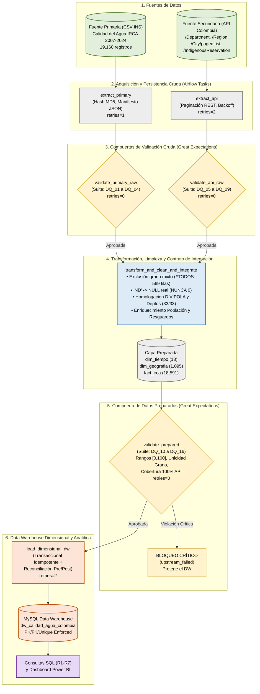

# Arquitectura de Alto Nivel del Sistema (Segunda Entrega)

Este diagrama representa las fuentes de datos, capas de persistencia cruda y preparada, las **3 compuertas de validación con Great Expectations**, el flujo de transformación e integración, la carga idempotente al Data Warehouse en MySQL, la capa analítica de BI y la orquestación completa con **Apache Airflow 3.1.8**.

