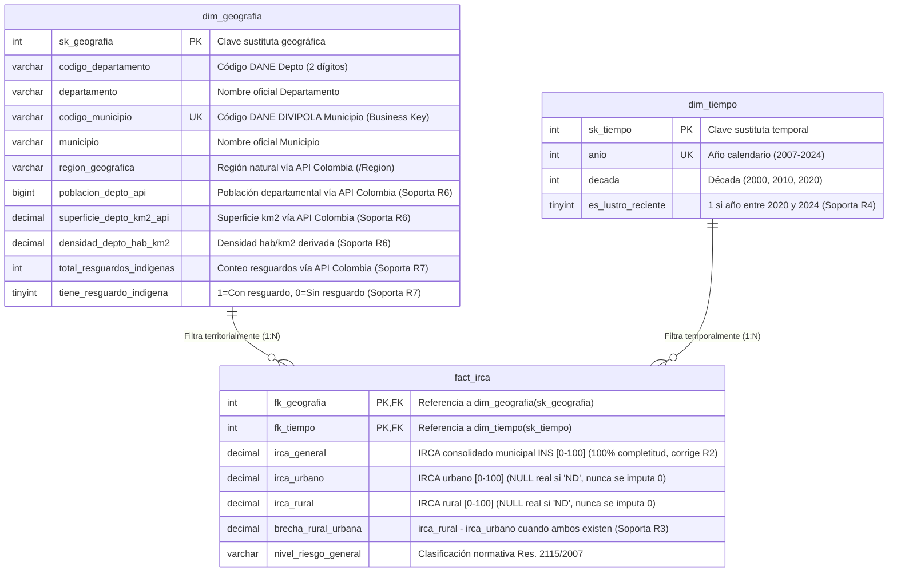

# Modelo Dimensional Refinado (Esquema Estrella - Segunda Entrega)

Este diagrama muestra la evolución desde el modelo base de la Primera Entrega hacia el **Esquema Estrella Refinado** de la Segunda Entrega, incorporando las claves oficiales DANE DIVIPOLA, el atributo consolidado `irca_general` (que corrige el sesgo de `COALESCE` en R2) y el enriquecimiento demográfico e indígena proveniente de **API Colombia** para responder R1–R7.

